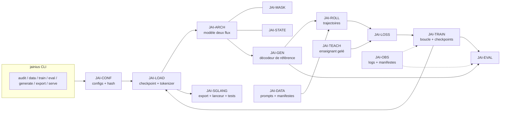
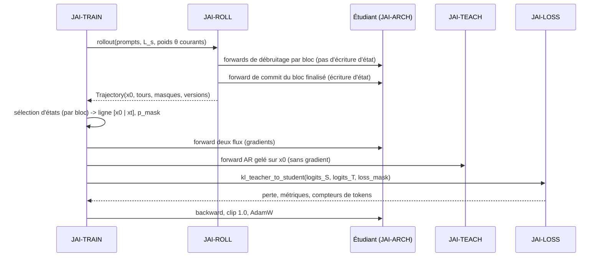
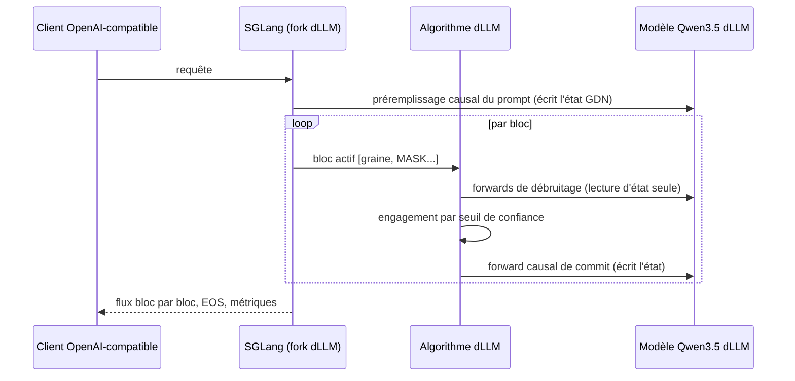
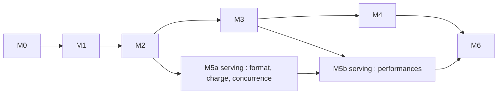

# Cahier technique — Jainius

## 1. Métadonnées et statut du document

| Champ | Valeur |
|---|---|
| Projet | Jainius — conversion AR → diffusion par blocs d'un modèle hybride Qwen3.5, avec serving SGLang |
| Document | Cahier technique (conception logicielle), `CAHIER_TECHNIQUE_JAINIUS.md` |
| Version / date | 0.1 — 10 octobre 2026 |
| Statut | Prêt pour revue. Rien n'est implémenté. Aucune performance n'a été mesurée. |
| Référence fonctionnelle | `Cahier_des_charges.md` v1.0 (9 octobre 2026). Ses exigences F-/S-/A- restent la référence. |
| Cible de développement | `Qwen/Qwen3.5-0.8B` (post-entraîné) |
| Classes de statut | **CONFIRMÉE** (source ou code lu) · **DÉCISION** (choix Jainius justifié) · **HYPOTHÈSE** · **À VÉRIFIER** · **EXPÉRIMENTAL** |

Les noms de composants `JAI-*` du cahier des charges (§4.1) sont conservés. Six composants sont ajoutés (`JAI-CONF`, `JAI-LOAD`, `JAI-DATA`, `JAI-GEN`, `JAI-OBS`, `JAI-CLI`), avec leur justification (§8).

---

## 2. Résumé des décisions structurantes

| ID | Décision | Statut | Justification | Révision si |
|---|---|---|---|---|
| D-01 | Source, enseignant et initialisation de l'étudiant : `Qwen/Qwen3.5-0.8B` (post-entraîné, non-thinking par défaut, Apache-2.0). `Qwen3.5-0.8B-Base` n'est qu'une variante d'ablation. | CONFIRMÉE | Fiche officielle HF. FLARE a converti des checkpoints Qwen3.5 post-entraînés. | L'enseignant post-entraîné s'avère trop faible (voir R-05) |
| D-02 | Seul le backbone texte est converti. Le vision encoder et la tête MTP sont ignorés par la diffusion et conservés tels quels à l'export. | DÉCISION | Le cahier ne demande pas de multimodalité. Les checkpoints FLARE gardent l'architecture `ConditionalGeneration`. | L'adaptateur d'état FLARE ne conserve pas ces poids (H-07) |
| D-03 | **Les dépôts FLARE et OPDLM servent d'oracles numériques et de références d'architecture, pas de dépendances.** Jainius écrit son propre chemin de référence en PyTorch. | DÉCISION | FLARE est sous **PolyForm Noncommercial 1.0.0**. OPDLM ne supporte pas l'hybride (§3.3). Un chemin de référence correct est exigé (cahier §4.2). | Gate LIC-1 (§20) validée en faveur du vendoring |
| D-04 | Méthode de conversion : OPDLM tel qu'implémenté dans le dépôt officiel. La transposition à Qwen3.5 hybride est **EXPÉRIMENTALE**. | CONFIRMÉE (méthode) / EXPÉRIMENTAL (hybride) | Aucune publication ni code ne valide OPDLM sur backbone hybride. | E1–E3 négatives |
| D-05 | Entraînement en deux flux `[x0 \| xt]`. Masque softmax et sémantique GDN repris de FLARE (masque lu dans le code). | CONFIRMÉE (masque) / HYPOTHÈSE (GDN, H-02) | Le code OPDLM utilise aussi une séquence étendue `[prompt; x0; xt]`. | Test d'équivalence échoué |
| D-06 | Convention de logits : commutateur `logit_convention ∈ {current, shifted}`. Défaut de référence : `current` (fidèle à OPDLM). `shifted` (Dream-style, FLARE) est une variante expérimentale isolée, adoptée seulement si l'expérience E1 la valide. | DÉCISION (M0) / EXPÉRIMENTAL pour `shifted` | `current` est le seul chemin fidèle à OPDLM sans H-01 résolue (§10.3). `shifted` est la seule convention disposant d'un chemin hybride démontré de bout en bout (entraînement + serving FLARE), mais sa cible KL n'est pas établie pour OPDLM. Conforme à AGENTS.md §4.3. | E1 |
| D-07 | Perte OPDLM : KL(p_enseignant ‖ p_étudiant), moyenne par ligne sur les positions masquées de la réponse, puis moyenne sur le batch. Vocabulaire complet par morceaux. Top-16 en repli mémoire. | CONFIRMÉE (code OPDLM) | §10.3. Le vocabulaire Qwen3.5 (248 320) est 1,6× celui de Qwen3. | — |
| D-08 | Sélection d'états : un tour de débruitage tiré par bloc (`one_state_per_block=True`, lanceurs officiels). L'Algorithme 1 du papier (un état par trajectoire) est une variante. | CONFIRMÉE (écart papier/code) | §4.2, I-03. | E2 |
| D-09 | Rollouts par un décodeur de référence PyTorch avec gestion explicite des états récurrents. Le moteur SGLang n'est utilisé qu'après profilage. | DÉCISION | JetEngine d'OPDLM ne supporte pas GDN. Les rollouts dominent le coût dans les méthodes on-policy (NPD : 82 %). | Profil M2 |
| D-10 | Deux modes de décodage : Diffusion-Trust (défaut) et AR-Trust. AR-Trust n'est supporté que si le flux clean reste aligné (régularisation E3). | DÉCISION / EXPÉRIMENTAL | OPDLM pur ne supervise pas le flux clean (§10.3). | E3 |
| D-11 | Serving : le chemin SGLang fonctionnel connu est le **fork modifié de FLARE** (SGLang + FlashInfer). SGLang amont fournit le framework dLLM mais pas Qwen3.5 dLLM. | CONFIRMÉE | §14.1. | Support amont de Qwen3.5 dLLM |
| D-12 | Méthodes complémentaires : d-OPD en premier candidat (conditionnel). TOPD rejetée. HOPD, TSD, NPD différées. | DÉCISION | §10.9. | Résultats des diagnostics |
| D-13 | Deux environnements verrouillés : `env-train` (Python 3.11) et `env-serve` (Python 3.10). | CONFIRMÉE (piles FLARE) | FLARE sépare entraînement et évaluation parce que les piles épinglées diffèrent. | Compatibilité démontrée (H-06) |
| D-14 | Pas d'interface utilisateur, pas de base de données, pas de service propre. CLI + API OpenAI-compatible de SGLang. | DÉCISION | Aucune exigence F- ne l'impose. | Besoin fonctionnel nouveau |

---

## 3. Références et périmètre de l'analyse

### 3.1 Documents lus

| Source | Lecture |
|---|---|
| Cahier des charges v1.0, STM (7 STM) | Intégrale |
| PDF NPD, OPDLM, TOPD, HOPD | Intégrale |
| PDF FLARE | Corps (§1–6), annexes B.3, B.4, D.1. Annexe A (dérivations de kernels) et annexe C survolées. |
| PDF TSD, d-OPD | Corps, ablations principales, limites. Annexes survolées. |
| Fiches HF `Qwen/Qwen3.5-0.8B` et `-Base` | Intégrale |
| Dépôt OPDLM, commit `3bb8bf6` (9 juin 2026) | README, `configs/rl_bd3lm.yaml`, `convert_qwen_to_bd3lm.py`, perte et préparation des états de `train/rl_sdar.py` (l. 40–135, 1255–1475), `requirements.txt`, lanceurs 4B/0.6B |
| Dépôt FLARE, commit `6ca547a` (17 août 2026) | READMEs, `dllm_args.py`, `dllm_model.py` (masque, tirage de masque, perte), `args.py` et flavors, config 2B, README des kernels, `eval/README.md`, `serve.sh`, scripts d'installation, algorithme Diffusion-Trust, noyau `DllmAlgorithm` |
| Dépôt d-OPD | README, `configs/method.yaml`, arborescence. **`dopd/core.py` non lu.** |
| Documentation SGLang (framework dLLM) et billet LMSYS du 19 déc. 2025 | Pages de documentation |

### 3.2 Non consulté

- Le `config.json` brut de Qwen3.5-0.8B. Les dimensions viennent de la fiche officielle et du flavor `0.8B` de FLARE, qui concordent.
- Le code source SGLang amont (seule la documentation a été lue). La version du fork FLARE n'est pas identifiable (`_version.py` absent).
- Les notes de version `transformers` (support de `qwen3_5`).
- Les licences des jeux de données OPDLM.
- Le schéma de rampe de longueur (curriculum) dans `rl.py` (`_scheduled_max_token`) et `make_basic_block_attention` d'OPDLM (non lus).

### 3.3 Faits vérifiés qui déterminent la conception

1. **Qwen3.5-0.8B** : 24 couches, dim 1024, motif 6 × (3 × GDN → FFN, puis 1 × attention gated → FFN). Soit 18 couches GDN et 6 d'attention aux indices 3, 7, 11, 15, 19, 23. GDN : 16 têtes V et 16 têtes QK, dim 128, conv noyau 4. Attention : 8 têtes Q, 2 KV, dim de tête 256, RoPE partielle (dim 64). FFN 3584. Vocabulaire 248 320 (padded), embeddings liés, MTP, vision encoder. Contexte 262 144.
2. **OPDLM cible Qwen3 (attention pure)** : `transformers==4.52.4`, `torch==2.6.0`, `flash-attn==2.7.4.post1`, `vllm==0.8.5.post1`, classe `a2d-qwen3`. Aucun code GDN. Les rollouts passent par JetEngine (SDAR).
3. **FLARE publie son code** : fork TorchTitan avec un flavor `0.8B`, noyaux GDN à deux flux (Triton), fork SGLang + FlashInfer (`qwen3_5_dllm.py`, `gdn_dllm_backend.py`, algorithmes `LowConfidenceShiftHybridDiffusion` et `HybridDiffusionSelfSpec`). Licence **PolyForm Noncommercial 1.0.0**.
4. **SGLang amont** : framework dLLM (`--dllm-algorithm`, `LowConfidence`, `JointThreshold`, ordonnancement FDFO). Modèles documentés : LLaDA2.0, SDAR, DiffusionGemma. Qwen3.5 en AR requiert la branche `main`.

---

## 4. Exigences fonctionnelles héritées, contraintes et écarts

### 4.1 Contraintes techniques

| ID | Contrainte | Origine |
|---|---|---|
| C-01 | Aucune modification de l'architecture ni du tokenizer hors le jeton de masque | Cahier §2 |
| C-02 | Chemin de référence correct avant tout noyau fusionné | Cahier §4.2, §7.2 |
| C-03 | États récurrents mis à jour uniquement par un forward sur bloc finalisé, jamais par les forwards de débruitage | Cahier §4.3 ; FLARE B.3 |
| C-04 | Isolation des documents (masque et resets d'état) | Cahier §4.2 ; FLARE |
| C-05 | Budgets suivis en tokens et en heures GPU, par phase | Cahier §6.4 |
| C-06 | Même matériel, mêmes prompts, mêmes règles de décodage pour B0/B1/B2 | Cahier §10.1 |
| C-07 | Licence FLARE non commerciale : toute reprise de son code est conditionnée à LIC-1 | Constat de cette analyse |

### 4.2 Incohérences et écarts à connaître

Aucune exigence du cahier des charges n'est modifiée. Chaque écart ci-dessous a une décision provisoire.

| ID | Constat | Impact | Décision |
|---|---|---|---|
| I-01 | **Terminologie des KL.** OPDLM nomme « forward KL » la perte KL(p_enseignant ‖ p_étudiant). TOPD et HOPD nomment « reverse KL » KL(p_étudiant ‖ p_enseignant). Le cahier écrit D_KL(p_AR ‖ p_θ). | Risque d'inverser la perte | Le code Jainius nomme les fonctions `kl_teacher_to_student` et `kl_student_to_teacher`. Jamais « forward/reverse » seul. |
| I-02 | OPDLM : le papier (Tab. 13) donne « 10 rollouts » pour atteindre la longueur finale (100 → 4 000). Le README du dépôt écrit « sur les 100 premiers pas ». d-OPD (même code) écrit « 100 itérations, cosinus ». | Le curriculum n'est pas fixé | `warmup_rollouts` = 100 par défaut, 10 en ablation (E4). Valeur et forme (linéaire / cosinus) à confirmer dans `rl.py` (H-09). |
| I-03 | OPDLM : l'Algorithme 1 tire **un état par trajectoire**. Les lanceurs officiels (4B, 0.6B) fixent `one_state_per_block=True` : un tour tiré **par bloc**, puis une ligne d'entraînement recomposée. Le défaut du YAML est `False` (tous les tours). | Trois variantes coexistent | Défaut : `per_block` (lanceurs). Les deux autres variantes sont configurables (E2). |
| I-04 | OPDLM : le papier ne mentionne pas de KL tronquée. Le README précise : vocabulaire complet à 0.6B/1.7B, top-16 de l'enseignant à 4B/8B (`training.top_k_logits=16`). | Détail de perte absent du papier | Vocabulaire complet par défaut à 0.8B, top-16 en repli (D-07). |
| I-05 | « Taille de bloc 4 » (cahier §6.3). FLARE le réalise par un `block_size` interne de **3** + un jeton « graine » sous le décalage de logits. OPDLM utilise 4 sans décalage. | Même valeur nominale, deux réalisations | `block_size` (logique) = 4 dans la config Jainius. Le décodeur et le serving dérivent la largeur de requête de la convention (§10.1). |
| I-06 | FLARE : le papier (STM) indique un warm-up de 500 pas. Le dépôt publié fixe `warmup_steps = 100`. | Hyperparamètre | Jainius utilise 100 pour tout entraînement FLARE-like. Non pertinent pour OPDLM. |
| I-07 | Seuil A-003 (≥ 98 % du composite source) : voir §13.4. Les retentions publiées sont de 69 % à 96 % (Qwen3, attention pure). | Seuil probablement hors de portée du prototype | Seuils échelonnés recommandés (§13.4). A-003 reste l'objectif final. |
| I-08 | Seuils A-003/A-004 sur Qwen3.5-0.8B : GPQA 11,9 %, MMLU-Pro 29,7 % (fiche). Plusieurs benchmarks du cahier sont au plancher de bruit. | Mesure non discriminante | Composite restreint aux benchmarks au-dessus du plancher (§13.3). |
| I-09 | STM-FLARE GAP-001/002/004 (loi du masque, décalage, optimiseur) : résolus par le code (§10.4). | — | Valeurs de FLARE reprises (statut CONFIRMÉE, code). |
| I-10 | Cahier §4.3 : « Diffusion-Trust ne sera activé par défaut qu'après validation ». Le même cahier fixe A-006 (débit) sur la charge représentative. | Cohérent | Pas d'écart. |

---

## 5. Architecture globale

### 5.1 Vue d'ensemble

Jainius est une bibliothèque Python avec une CLI. Elle n'introduit aucun service propre. Le serving est assuré par SGLang. La bibliothèque est séparée en deux chemins :

- **Chemin de référence** (`jainius/`) : PyTorch pur, correct, lent, testable. Il définit la vérité numérique.
- **Chemin rapide** (kernels FLARE si LIC-1, sinon développements Jainius après profilage) : optionnel, toujours validé contre le chemin de référence.

### 5.2 Frontière entre l'existant et le code à écrire

| Élément | Origine | Statut |
|---|---|---|
| Poids, tokenizer, chat template Qwen3.5-0.8B | Hugging Face (Apache-2.0) | Réutilisé |
| Modules GDN / attention gated de `transformers` (projections, normes, gates) | `transformers` | Réutilisé (`env-train`) |
| Noyaux GDN chunked (`flash-linear-attention`, MIT) | Bibliothèque externe | Réutilisé pour le flux clean (H-06) |
| Noyaux GDN à deux flux, SGLang/FlashInfer modifiés | FLARE (PolyForm NC) | **Oracle, ou vendoring après LIC-1** |
| Boucle OPDLM, perte, curriculum | OPDLM (MIT) | **Réimplémenté** (référence de comportement) |
| Masques, états récurrents, rollouts, perte, entraîneur, évaluation, adaptation serveur | Jainius | **À développer** |

### 5.3 Parcours complet

Checkpoint source → audit (empreintes) → modèle de référence deux flux → vérification d'équivalence AR → rollouts de l'étudiant → états d'entraînement → cibles de l'enseignant → perte → mise à jour → évaluation → export HF → chargement SGLang → génération.

---

## 6. Diagrammes et flux d'exécution

### 6.1 Composants



### 6.2 Un pas d'entraînement OPDLM



### 6.3 Serving (cible)



---

## 7. Structure du dépôt

```
jainius/
├── pyproject.toml            # métadonnées, ruff, pytest, mypy ; deux groupes : train, serve
├── uv.lock / uv.serve.lock   # verrous des deux environnements (D-13)
├── README.md                 # installation et commandes uniquement
├── configs/                  # YAML versionnés (un fichier par modèle, méthode, entraînement, évaluation, serving)
├── src/jainius/
│   ├── config/    schema.py, load.py
│   ├── ckpt/      loader.py, fingerprint.py, export.py
│   ├── model/     arch.py, masks.py, gdn_ref.py, convention.py, tokens.py   (+ gdn_fast.py après M6)
│   ├── data/      prompts.py, manifest.py, template.py
│   ├── decode/    sampler.py, generate.py, rollout.py, trajectory.py
│   ├── distill/   teacher.py, states.py, loss.py, curriculum.py
│   ├── train/     loop.py, state.py, budget.py
│   ├── eval/      harness.py, protocol.py, metrics.py, benchmarks/
│   ├── serve/     export_sglang.py, launch.py, compat.py
│   ├── obs/       manifest.py, logging.py
│   └── cli.py
├── tools/oracle_flare/       # scripts de comparaison à un checkout FLARE (hors package, usage interne)
├── tests/{unit,numerical,integration,serve}/
└── experiments/registry.jsonl
```

| Module | Rôle | Dépendances autorisées | Tests |
|---|---|---|---|
| `config` | Dataclasses, chargement YAML strict, hash canonique | stdlib, PyYAML | `unit/test_config.py` |
| `ckpt` | Chargement HF, empreintes, export HF + `jainius.json` | `config`, `torch`, `transformers`, `safetensors` | `test_loader.py`, `test_export.py` |
| `model` | Modèle deux flux, masques, états, convention, jeton de masque | `config`, `ckpt`, `torch`, `fla` (flux clean) | `numerical/test_masks.py`, `test_gdn_*.py`, `test_ar_equivalence.py` |
| `data` | Lecture des prompts, gabarit de chat, manifestes | `config`, `tokenizers`/`transformers` | `test_data.py` |
| `decode` | Échantillonneur par blocs, générateur, rollouts, trajectoires | `model`, `data` | `test_sampler.py`, `test_rollout.py` |
| `distill` | Enseignant, sélection d'états, perte, curriculum | `model`, `decode` | `test_loss.py`, `test_states.py`, `test_curriculum.py` |
| `train` | Boucle, reprise, budgets | `distill`, `obs`, `ckpt` | `integration/test_resume.py` |
| `eval` | Harnais, protocole, métriques | `decode`, `data`, `obs` | `test_eval_protocol.py` |
| `serve` | Export SGLang, lanceur, tests de compatibilité | `ckpt`, `eval` (pas de `torch` obligatoire côté client) | `serve/` |
| `obs` | Manifestes, logs JSONL | stdlib | `test_obs.py` |
| `cli` | Point d'entrée | tous | `test_cli.py` |

Règles : `model` ne dépend ni de `distill` ni de `train`. `decode` ne dépend pas de `distill`. `serve` n'importe pas `train`. Aucun fichier de configuration hors `configs/`.

---

## 8. Spécification des composants

Les six composants ajoutés au cahier des charges le sont pour les raisons suivantes : `JAI-CONF`, `JAI-LOAD` et `JAI-DATA` portent F-001, F-002, F-012 (empreintes, tokenizer, manifestes) ; `JAI-GEN` porte F-009 (chemin de génération de référence) ; `JAI-OBS` porte F-012 (traçabilité) ; `JAI-CLI` porte le pilotage (§15). Chacun tient en un module.

### JAI-CONF — configurations
- **Objectif** : une configuration typée, validée et hachée par expérience.
- **Responsable de** : schéma, rejet des clés inconnues, hash canonique (SHA-256 du YAML normalisé), surcharges CLI.
- **Hors périmètre** : tout calcul.
- **Erreurs** : `ConfigError` (clé inconnue, valeur incohérente, p. ex. `logit_convention` incompatible avec `block_size`).
- **Acceptation** : deux chargements du même fichier donnent le même hash ; une clé inconnue est refusée.

### JAI-LOAD — chargement et validation du checkpoint
- **Objectif** : charger le checkpoint source et garantir F-001/F-002.
- **Responsable de** : chargement du backbone texte, empreinte par tenseur (SHA-256 des octets + dtype + forme), comparaison à un fichier `source_fingerprint.json` généré à l'audit (M0), vérification du tokenizer (vocabulaire, jetons spéciaux, gabarit de chat), vérification du jeton de masque (§10.1), export.
- **Hors périmètre** : conversion de poids (aucune), entraînement.
- **Erreurs** : `FingerprintMismatch`, `TokenizerMismatch`, `MaskTokenCollision`.
- **Acceptation** : T-LOAD-01, T-TOK-01.

### JAI-ARCH — modèle deux flux
- **Objectif** : réaliser le forward `[x0 | xt]` d'entraînement, le forward causal (AR, préremplissage, commit) et le forward de débruitage, sans modifier les poids.
- **Responsable de** : orchestration des 24 couches, choix du masque softmax (JAI-MASK) et du calcul GDN (JAI-STATE), calcul paresseux des logits (par morceaux).
- **Hors périmètre** : perte, rollouts, optimisation.
- **Dépendances** : modules de couches HF, `fla`.
- **Erreurs** : `ConventionMismatch` (entrées incompatibles avec la convention), `StateLeakError`.
- **Acceptation** : T-AR-01 (équivalence AR), T-MASK-*, T-GDN-*.

### JAI-MASK — masques et frontières
- **Objectif** : construire les vues masquées, les masques deux flux et l'isolation des documents.
- **Responsable de** : `[x0|xt]` softmax (§10.2), tirage du masque d'entraînement (§10.4), identifiants de documents.
- **Hors périmètre** : état récurrent.
- **Acceptation** : T-MASK-01…03 (table de vérité exacte, F-003).

### JAI-STATE — état récurrent
- **Objectif** : sauvegarder, restaurer, réinitialiser et valider les états des 18 couches GDN, ainsi que les caches KV des 6 couches d'attention.
- **Responsable de** : sémantique de référence des deux flux (§10.2), snapshot/restore, garde « aucune écriture pendant le débruitage ».
- **Hors périmètre** : kernels fusionnés (M6).
- **Erreurs** : `StateLeakError` (état modifié par un forward de débruitage, ou partagé entre deux requêtes).
- **Acceptation** : T-STATE-01…03.

### JAI-ROLL — rollouts
- **Objectif** : produire des trajectoires de débruitage reproductibles (F-004) avec l'étudiant courant.
- **Responsable de** : décodage par blocs, enregistrement des tours (`Trajectory`), version du modèle, seed.
- **Hors périmètre** : perte, enseignant.
- **Acceptation** : T-ROLL-01 (même seed, mêmes versions → même trajectoire).

### JAI-TEACH — enseignant
- **Objectif** : fournir les distributions de l'enseignant gelé (F-005).
- **Responsable de** : forward AR gelé, `requires_grad=False`, `eval()`, empreinte inchangée en fin d'entraînement, alignement des indices selon la convention (§10.3).
- **Acceptation** : T-TEACH-01, T-TEACH-02 (équivalence avec la construction du dépôt OPDLM, H-03).

### JAI-LOSS — distillation
- **Objectif** : KL teacher→student masquée, normalisée, finie et différentiable (F-006).
- **Responsable de** : calcul par morceaux, top-k optionnel, sécurité `-inf`, normalisation, métriques par tour.
- **Acceptation** : T-LOSS-01…04.

### JAI-TRAIN — entraînement
- **Objectif** : boucle on-policy, curriculum, checkpoints, reprise (F-007, F-008).
- **Responsable de** : orchestration, versionnage des trajectoires, sauvegarde atomique de l'état complet, budgets (C-05), arrêt contrôlé (signal, `NonFiniteLoss`).
- **Acceptation** : T-CKPT-01, T-CURR-01.

### JAI-GEN — générateur de référence
- **Objectif** : génération de bout en bout (F-009), Diffusion-Trust et AR-Trust de référence, utilisée par l'évaluation avant SGLang.
- **Responsable de** : échantillonneur statique/dynamique, arrêt EOS, limites, état par requête.
- **Hors périmètre** : concurrence (SGLang).

### JAI-EVAL — évaluation
- **Objectif** : protocole contrôlé B0/B1/B2 (F-011, A-003…A-007).
- **Responsable de** : adaptateurs de benchmarks, extraction de réponses, métriques, hash du protocole, séparation des modes.
- **Hors périmètre** : génération (délègue à JAI-GEN ou au serveur).

### JAI-SGLANG — intégration serveur
- **Objectif** : export compatible SGLang, lanceur, tests de compatibilité (F-010, S-001…S-007).
- **Responsable de** : génération de `config.json` + `jainius.json`, lancement avec le fork validé, clients de test, collecte des métriques serveur.
- **Hors périmètre** : modification du moteur (voir §14.3 pour les options).

### JAI-OBS — observabilité
- **Objectif** : manifestes de run et logs JSONL (F-012).
- **Responsable de** : manifeste (SHA du code, hash des verrous, hash de configuration, manifeste de données, seeds, matériel, pilote, CUDA), métriques structurées.

### JAI-DATA — données
- **Objectif** : prompts, gabarit de chat, manifestes (§11.1).
- **Responsable de** : lecture des prompts OPDLM, déduplication, séparation entraînement/validation/test, contrôle de contamination.

### JAI-CLI — pilotage
Voir §15.

---

## 9. Contrats et interfaces

Conventions : `B` batch, `L` longueur de séquence, `Lr` longueur de réponse, `D=1024`, `V=248320`. Tous les index sont positionnels. Les tenseurs d'indices sont `int64`. Les activations sont `bfloat16`. L'état GDN est stocké en `float32`.

### 9.1 Types de base

```python
@dataclass(frozen=True)
class DiffusionSpec:
    block_size: int = 4                        # taille logique B (cahier §6.3)
    logit_convention: Literal["current", "shifted"] = "current"   # référence OPDLM (D-06) ; "shifted" = variante expérimentale isolée, cf. E1
    mask_token_id: int = 248077                # valeur FLARE ; à valider (T-TOK-01)
    pad_token_id: int = 248044
    causal_x0: bool = True                     # requis pour AR-Trust et la perte clean
    causal_xt: bool = False                    # xt bidirectionnel intra-bloc

    @property
    def unit_block(self) -> int:               # taille du bloc masqué en entraînement
        return self.block_size - 1 if self.logit_convention == "shifted" else self.block_size

@dataclass
class TwoStreamBatch:
    x0: LongTensor          # [B, L]  séquence propre (prompt + réponse)
    xt: LongTensor          # [B, L]  x0 avec mask_token_id aux positions masquées
    sup_mask: BoolTensor    # [B, L]  positions supervisées (réponse, avant le premier EOS inclus/exclu selon config)
    doc_ids: LongTensor | None   # [B, L] identifiants de document (packing) ; None si pas de packing
    prompt_len: LongTensor  # [B]
```

`unit_block = 3` sous `shifted` reproduit le `block_size = 3` interne de FLARE (I-05).

### 9.2 Modèle

```python
class JainiusModel(nn.Module):
    spec: DiffusionSpec

    def forward_two_stream(self, batch: TwoStreamBatch) -> TwoStreamHidden: ...
        # h_x0, h_xt : [B, L, D]. Aucun logit matérialisé.

    def lm_logits(self, h: Tensor, index: LongTensor | None = None, *, chunk: int = 1024) -> Tensor: ...
        # h : [N, D] ou [B, L, D] ; renvoie [N, V] float32 (par morceaux si demandé)

    def prefill(self, ids: LongTensor, state: RecurrentState | None = None) -> tuple[Tensor, RecurrentState]: ...
        # causal ; ÉCRIT l'état ; sert au préremplissage et au commit d'un bloc finalisé

    def denoise(self, block_ids: LongTensor, state: RecurrentState) -> Tensor: ...
        # block_ids : [B, unit_block] contenant des mask_token_id ; LIT l'état sans l'écrire ;
        # renvoie les logits [B, unit_block(+1 si shifted), V]
```

Invariants : `denoise` ne modifie ni `state` ni les caches (vérifié par T-STATE-02). `prefill` avec masque causal reproduit le forward AR de `transformers` (T-AR-01).

### 9.3 État récurrent

```python
@dataclass
class RecurrentState:
    gdn: list[GdnLayerState]    # 18 éléments : S [B, H=16, Dk=128, Dv=128] float32 ; conv [B, C, K-1=3]
    kv: list[KvLayerCache]      # 6 éléments (couches 3, 7, 11, 15, 19, 23)
    length: LongTensor          # [B]
    def snapshot(self) -> "RecurrentState": ...      # copie profonde, bit-exacte
    def restore(self, snap: "RecurrentState") -> None: ...
    def reset(self, rows: BoolTensor) -> None: ...   # remise à zéro de lignes (frontière de document / nouvelle requête)
```

### 9.4 Trajectoires et échantillonneur

```python
@dataclass(frozen=True)
class SamplerSpec:
    mode: Literal["static", "dynamic"] = "dynamic"
    threshold: float = 0.9                 # dynamique : commit si confiance >= seuil, repli sur le top-1
    steps_per_block: int = 4
    temperature: float = 1.0
    top_p: float = 1.0
    top_k: int = 0                         # 0 = désactivé

@dataclass
class Round:                               # un tour de débruitage d'un bloc
    block: int
    step: int
    ids: LongTensor                        # [unit_block] état d'entrée du tour (avec MASK)
    committed: BoolTensor                  # [unit_block]

@dataclass
class Trajectory:
    prompt_ids: LongTensor                 # [Lp]
    x0: LongTensor                         # [Lr] séquence terminale
    rounds: list[Round]
    model_version: str                     # hash du checkpoint étudiant ayant produit la trajectoire
    seed: int
    sampler: SamplerSpec
    n_forwards: int
```

### 9.5 Perte

```python
@dataclass
class LossOutput:
    loss: Tensor                  # scalaire, différentiable
    per_row: Tensor               # [B]
    n_supervised: int             # tokens dans la perte
    kl_by_masked_fraction: dict[str, float]

def kl_teacher_to_student(
    h_student: Tensor, lm_student: Callable[[Tensor], Tensor],
    h_teacher: Tensor, lm_teacher: Callable[[Tensor], Tensor],
    sup_mask: BoolTensor, *,
    chunk_tokens: int = 1024,
    top_k: int | None = None,         # None = vocabulaire complet ; 16 = repli (I-04)
) -> LossOutput: ...
# Normalisation : somme sur positions supervisées de chaque ligne / max(1, n positions de la ligne),
# puis moyenne sur les lignes. (CONFIRMÉE, dépôt OPDLM.)
```

Invariants : `loss ≥ 0` ; `loss == 0` si les distributions sont égales ; les entrées `-inf` de l'enseignant contribuent 0 (pas de NaN) ; résultat identique (tolérance) avec ou sans découpage en morceaux.

### 9.6 Enseignant, états, curriculum

```python
class Teacher:
    def __init__(self, model: nn.Module, spec: DiffusionSpec): ...   # gèle les paramètres
    @torch.no_grad()
    def hidden(self, batch: TwoStreamBatch) -> Tensor: ...           # [B, L, D], aligné sur la convention

def select_states(traj: Trajectory, *, policy: Literal["per_block", "per_trajectory", "all_rounds"],
                  rng: torch.Generator) -> tuple[LongTensor, BoolTensor]: ...   # (xt [L], p_mask [L])

def rollout_length(step: int, *, l_min: int = 100, l_max: int = 4000, warmup_rollouts: int = 100,
                   shape: Literal["linear", "cosine"] = "linear") -> int: ...
```

### 9.7 Erreurs

| Exception | Levée quand | Réaction |
|---|---|---|
| `FingerprintMismatch` | Un tenseur source diffère de l'empreinte | Arrêt immédiat |
| `MaskTokenCollision` | L'id de masque est utilisé par un jeton du tokenizer ou a un embedding dégénéré | Arrêt |
| `StateLeakError` | Un forward de débruitage modifie l'état, ou deux requêtes partagent un état | Arrêt, test échoué |
| `NonFiniteLoss` | Perte NaN/Inf | Sauvegarde d'urgence, arrêt contrôlé |
| `TrajectoryVersionMismatch` | Trajectoire produite par une autre version que celle qui l'optimise (hors tolérance configurée) | Rejet de la ligne |
| `ResumeMismatch` | Reprise avec une configuration, un code ou des verrous différents | Refus, sauf `--force` journalisé |

### 9.8 Formats d'artefacts

- **Checkpoint modèle** : répertoire HF (`model.safetensors` BF16, tokenizer, `config.json`) plus `jainius.json` : `{source_sha, code_sha, lock_hash, config_hash, spec: DiffusionSpec, sampler_defaults, metrics_ref, data_manifest_hash}`.
- **État d'entraînement** (répertoire séparé) : optimiseur, planificateur, RNG (CPU/CUDA), pas de curriculum, curseur de données, compteurs de budget, hash de configuration.
- **Manifeste de run** : `runs/<id>/manifest.json`. **Métriques** : `runs/<id>/metrics.jsonl` (une ligne par pas, clés stables).
- **Manifeste de données** : sources, révisions HF, licences, règles de filtrage, statistiques avant/après, hash du contenu.

---

## 10. Spécification algorithmique

Légende des sources : **[P]** publication, **[C]** code lu (dépôt et commit indiqués §3.1), **[J]** extrapolation Jainius (HYPOTHÈSE ou PROPOSITION, toujours signalée).

### 10.1 Convention de logits et jeton de masque

| Convention | Définition | Source |
|---|---|---|
| `current` | Le logit à la position *i* prédit le jeton *i*. Le logit de l'enseignant est décalé d'un cran (`roll`) pour s'aligner. `student_arm_shift=False` par défaut. | OPDLM [C] `train/rl_sdar.py` l. 1269, 1347 |
| `shifted` (Dream-style) | Le logit à la position *i* prédit le jeton *i+1*. Étiquettes décalées (`labels[i] = original[i+1]`), étiquettes mises à −100 aux frontières de documents, `diff_labels[~masked_indices] = -100`. | FLARE [C] `dllm_model.py` l. 235–250, 730–760 |

Sous `shifted`, le bloc d'exécution est `[graine, MASK, …]` : le dernier logit échantillonne la graine du bloc suivant (FLARE [C], `low_confidence_shift_hybrid_diffusion.py`). C'est pourquoi `unit_block = B − 1` (I-05).

**Jeton de masque** : id `248077`, « valide dans le vocabulaire du modèle mais volontairement absent du tokenizer » (FLARE [C], `eval/README.md`). `eos/pad = 248044`. Les embeddings étant liés à la tête de sortie, la ligne 248077 est aussi une ligne de sortie. Test T-TOK-01 : l'id est < 248 320, n'est le résultat d'aucun encodage du tokenizer, et sa norme d'embedding n'est pas dégénérée.

**Statut de D-06** : l'effet de la convention sur la rétention de capacité n'a pas été comparé dans une même publication pour OPDLM. FLARE rapporte l'effet du décalage comme marginal (STM-2, Tab. 12–13). L'expérience E1 (§13.6) tranche.

### 10.2 Forward deux flux

**Entrée** : `TwoStreamBatch` (§9.1). **Sortie** : `h_x0`, `h_xt` `[B, L, D]`.

**Positions** : les jetons de `xt` reçoivent les mêmes identifiants de position que `x0` ; avec packing, les positions repartent de 0 à chaque document (FLARE [C] `_build_block_diffusion_inputs`, `_doc_ids_to_positions`).

**Couches d'attention softmax (6 couches)** — masque exact FLARE [C] `_block_diff_mask_x0_xt`, avec `n = L`, `q_pos`/`kv_pos` positions dans le flux, `blk = pos // unit_block` :

```
x0_mask    = (q∈x0) & (kv∈x0) & ( q_pos >= kv_pos            si causal_x0
                                  | q_blk >= kv_blk           sinon )
xt_mask    = (q∈xt) & (kv∈xt) & (q_blk == kv_blk) [& q_pos >= kv_pos si causal_xt]
cross_mask = (q∈xt) & (kv∈x0) & (q_blk > kv_blk)              # xt voit les blocs x0 STRICTEMENT antérieurs
mask       = (x0_mask | xt_mask | cross_mask) & (doc_ids[q] == doc_ids[kv])
```

Jainius fixe `causal_x0=True`, `causal_xt=False` (requis par `ar_loss_weight > 0` et AR-Trust, FLARE [C] `_validate_dllm`).

**Couches GDN (18 couches)** — sémantique de référence **[J] à valider par l'oracle (H-02)**. Elle est dérivée de FLARE [P] Éq. (6) et du README des kernels [C] :

- Récurrence token-causale : `h_t = e^{g_t} h_{t-1} + k_t ⊗ β_t (v_t − k_tᵀ e^{g_t} h_{t-1})`. La mise à jour reste causale pour les deux flux.
- **Flux clean** : GDN causal standard. Les états aux frontières de blocs `S_clean(s_b)` sont conservés (réf. : boucle séquentielle ; chemin rapide : `fla.chunk_gated_delta_rule` aux frontières, H-06).
- **Flux noisy, bloc *b*** : état initial `S̃ ← S_clean(s_b)` ; mise à jour par les `unit_block` jetons bruités ; **lecture de tous les jetons du bloc dans l'état de fin de bloc** `S̃_end` (bidirectionnalité intra-bloc). Aucune écriture de `S̃` vers le flux clean au forward. Le gradient du flux noisy remonte vers la récurrence clean par `S_clean(s_b)`.
- **Convolution courte (noyau 4)** : le contexte gauche des premiers jetons d'un bloc bruité (clean ou bruité ?) n'est pas déterminé par les documents lus. À trancher par comparaison à `block_train_conv` (H-02).
- **Isolation** : remise à zéro de l'état et du contexte de convolution à chaque frontière de document (`cu_seqlens` dans FLARE).

**Propriété exploitable [J]** : les blocs bruités sont indépendants conditionnellement aux états `S_clean(s_b)`. Le chemin de référence peut donc les traiter en parallèle sur un axe de batch (`num_blocks × unit_block`), ce qui évite la boucle séquentielle sur les blocs. Seul le calcul des `S_clean(s_b)` reste séquentiel dans le chemin de référence.

### 10.3 Pas d'entraînement OPDLM

**Source** : OPDLM [P] Alg. 1, Éq. (4)–(5) ; implémentation [C] `train/rl_sdar.py` (fonctions `_combine_rounds_one_state_per_block`, perte BD3LM l. 1255–1475).

**Préconditions** : étudiant initialisé du checkpoint source (D-01) ; enseignant = checkpoint source gelé ; `DiffusionSpec` validée ; longueur de rollout `L_s` fournie par le curriculum.

**Étapes**

1. **Rollout** : pour 128 prompts (paramètre `tasks_per_step`), l'étudiant courant génère une trajectoire avec le `SamplerSpec` (§10.5). On obtient la séquence terminale `x0` et les tours de chaque bloc.
2. **Sélection d'état** `select_states` :
   - `per_block` (défaut, lanceurs [C]) : pour chaque bloc, parmi les tours où le bloc contient au moins un `MASK`, tirer un tour uniformément ; recomposer une ligne `xt` et un `p_mask` à partir des tours choisis. Une ligne par prompt.
   - `per_trajectory` (papier, Alg. 1) : un tour `k ∼ U{1..T}` pour toute la trajectoire.
   - `all_rounds` (défaut du YAML [C]) : toutes les lignes.
   - `random_mask` (ablation, [C] `_combine_rounds_random_mask`) : par bloc, `t ∼ U(0,1)` puis masquage de Bernoulli(t), au moins un masque par bloc.
3. **Student forward** deux flux sur `[prompt ; x0 ; xt]` (§10.2). Les logits sont calculés uniquement aux positions supervisées.
4. **Teacher forward** gelé, sans gradient. La cible à une position masquée est `p_AR(· | x0_{<b}, x0_{b,<i})`, soit la distribution AR sur le **préfixe clean de la séquence terminale**. [P] Éq. de l'OPDLM objective.
   - Dans le dépôt [C], l'enseignant traite une séquence étendue (`teacher_fill = clean_fill` par défaut : les `MASK` de `xt` sont remplacés par les jetons de `x0`), avec masque causal et `roll`. **Hypothèse H-03 [J]** : sous `clean_fill`, c'est mathématiquement un forward AR de l'enseignant sur `x0` seul (`L` jetons au lieu de `2L`), aligné par la convention. Jainius implémente le forward AR simple, et T-TEACH-02 vérifie l'équivalence avec la construction du dépôt sur Qwen3 (checkout OPDLM).
   - Alignement `current` : cible de la position *i* = logit enseignant à *i−1*. Alignement `shifted` : cible de la position *j* = logit enseignant à *j* sur `x0`. **Le choix des positions supervisées sous `shifted` n'est pas établi pour OPDLM (H-01)**. Voir « Questions ouvertes » ci-dessous.
5. **Masque de perte** `sup_mask` = positions de réponse ∧ jetons `MASK` dans `xt` ∧ avant le premier `<|im_end|>` ∧ ≠ `<|im_end|>` lui-même (`exclude_im_end: True`) ∧ non-pad. [C]
6. **Perte** (D-07) : `ℓ_i = Σ_v p_T(v) (log p_T(v) − log p_S(v))` ; moyenne par ligne sur `sup_mask`, puis moyenne sur les lignes. Poids `w(t) = 1`. [P][C]
7. **Mise à jour** : `backward`, clipping 1,0, AdamW. Le curriculum avance d'un pas. Un tour de rollout = un pas d'optimisation de lot (le batch effectif 8 lignes est atteint par accumulation).

**Postconditions** : perte finie ; `n_supervised > 0` ; poids de l'enseignant inchangés.

**Questions ouvertes (bloquantes pour E1)**
- **H-01** : sous `shifted`, la ligne `xt` masque des positions *j* dont le logit prédit *j+1*. Quelles positions reçoivent une cible de l'enseignant, et la cible conditionne-t-elle sur `x0_j` que l'étudiant ne voit pas ? Le code FLARE fixe la règle pour son entraînement CE (`diff_labels[~masked_indices] = −100`). La règle pour une cible KL doit être choisie puis testée par E1. Jusqu'à E1, **`current` est le seul chemin fidèle à OPDLM**.
- Conséquence pour D-06 : le défaut de référence est `current`. `shifted` n'est adopté que si E1 le valide (H-01 résolue **et** composite dev ≥ `current` − 1 écart-type inter-seeds **et** chemin serving existant, cf. §13.6). Aucune bascule silencieuse entre conventions.

### 10.4 Tirage du masque d'entraînement FLARE (option, objectif FLARE seul)

[C] `_sample_block_mask_probabilities`, `_sample_block_diffusion_mask` : une probabilité `p_b ∼ U(0,1)` par bloc, échantillonnage **antithétique/stratifié** sur l'ensemble des blocs du batch (`antithetic_sampling=True`), masquage `U ≤ p_b` par position, jamais sur les positions `labels = −100`. Vues complémentaires (`complementary_mask=True` dans la config publiée) : le complément du masque est utilisé comme seconde vue.

Résout les GAP FLARE-001 (loi du masque) et FLARE-002 (formule du décalage). **Perte FLARE publiée** : `L = L_AR + L_diff` (pas de normalisation : `loss_normalize=false`, `ar_loss_weight=1.0`). AdamW (β = 0,9 / 0,999, ε = 1e-8, weight decay 0), LR 1e-5 constant après 100 pas de warm-up, clipping 1,0, séquences de 4096, batch global 256, 9000 pas, bf16.

Cet objectif n'est **pas** la baseline Jainius (D-04). Il n'est implémenté que pour E3 (§13.6) et pour servir d'oracle.

### 10.5 Échantillonneur et décodage

**Diffusion-Trust, chemin de référence** (FLARE [P] Alg. 1, 12 ; [C] docstring `LowConfidenceShiftHybridDiffusion`) :

1. Préremplissage causal du prompt (`prefill`, écrit l'état).
2. Pour chaque bloc : construire l'entrée (`current` : `[MASK]×B` ; `shifted` : `[graine, MASK×(B−2)]`).
3. Boucle de débruitage (au plus `steps_per_block`) avec `denoise` (aucune écriture d'état). Engagement :
   - `dynamic` : toute position de confiance ≥ τ ; repli sur la position de plus haute confiance si aucune ne qualifie.
   - `static` : les `B/K` positions de plus haute confiance.
4. Quand le bloc est complet : `prefill` causal du bloc finalisé (écrit l'état).
5. Arrêt : EOS, `max_new_tokens`, ou annulation.

Valeurs publiées (FLARE [C] `hybrid_diffusion_shift_b3_g1.yaml`) : seuil 0,95, température 1,0, top-k 20, top-p 0,95. Valeurs OPDLM (rollouts) : seuil 0,9, température 1,0, top-p 1,0, top-k 0.

**H-08** : définition de la « confiance » (probabilité du jeton échantillonné ou probabilité maximale) non vérifiée dans le code OPDLM. TOPD/HOPD (lignée SDAR) utilisent la probabilité du jeton échantillonné ; FLARE utilise `max_v p`. `confidence ∈ {sampled_token_prob, max_prob}` est un paramètre, défaut `sampled_token_prob` pour les rollouts.

**AR-Trust** (EXPÉRIMENTAL) : brouillons issus du flux noisy, vérifiés par les logits du flux clean (FLARE [P] Éq. 8, Alg. 2, 11). Largeur active `2N−1 = 7` pour `N = 4`, politique `Exact-Truncated` (`strict_truncated`) dans la config publiée [C]. La validité exige que le flux clean reproduise la loi AR : non garantie par OPDLM pur (D-10).

### 10.6 Curriculum de longueur

[P] `L_s = min(L_max, L_min + ⌊s / S_warm · (L_max − L_min)⌋)` avec `L_min = 100`, `L_max = 4000` [P][C]. `S_warm` : voir I-02 (défaut 100, ablation 10). Plafonds par domaine du YAML [C] : maths 4096, code 2048, chat 2048, sciences 1024 (`min(L_s, plafond)`). Test T-CURR-01 : valeurs exactes aux pas 0, S_warm/2, S_warm, au-delà.

### 10.7 Correction d-OPD (conditionnelle)

[P] STM-7 Éq. (13)–(19) ; [C] README et `method.yaml` (`block_size 4`, `top_k 16`, `correctness_gate: true`) ; **`dopd/core.py` non lu**. Cible corrigée pour une position masquée *i* : `p̃(v) ∝ r_i(v) · exp(Δs_i(v))`, `Δs_i(v) = s_i(v) − s_i(x̂_i)`, `s_i(v) = log p_T(Ĉ_i | …, v)`, restreinte à l'union des top-16 enseignant et étudiant, appliquée seulement aux réponses jugées correctes.

**Spécificité hybride [J]** : chaque candidat *v* exige un forward de l'enseignant sur le suffixe `Ĉ_i` (≤ `B−1` jetons) à partir d'un **instantané d'état** `RecurrentState.snapshot()` du préfixe. Jusqu'à 33 branches par position. Le coût est borné par la longueur du suffixe mais impose une API d'instantanés d'état peu coûteuse (§9.3). Intégration conditionnée à E5 (§10.9).

### 10.8 Matrice FLARE

| Composant FLARE | Rôle | Dépendances | Compatibilité vérifiée | Adaptation | Statut |
|---|---|---|---|---|---|
| Masque deux flux `_block_diff_mask_x0_xt` | Softmax | PyTorch (flex attention ou masque dense) | Code lu ; flavor `0.8B` présent | Réécriture en masque dense pour la référence | CONFIRMÉE |
| Tirage de masque (antithétique, complémentaire) | Objectif FLARE | PyTorch | Code lu | Option E3 | CONFIRMÉE |
| Perte décalée (labels, frontières de documents) | Objectif FLARE | — | Code lu | Voir H-01 pour une cible KL | CONFIRMÉE (CE) / HYPOTHÈSE (KL) |
| GDN deux flux (WY, Triton) | Entraînement efficace | `fla` 0.5.1, Triton, torch 2.10 | Flavor `0.8B` : `linear_num_value_heads=16`. Perf non mesurée à 0.8B | Oracle ; vendoring selon LIC-1 | À VÉRIFIER |
| ShortConv deux flux | Convolution par bloc | Triton | Idem | Idem | À VÉRIFIER |
| Algorithmes `LowConfidenceShiftHybridDiffusion`, `HybridDiffusionSelfSpec` | Décodage serveur | Fork SGLang | Code lu (partiel) | Voir §14 | CONFIRMÉE |
| `fused_verify_kernel` | AR-Trust | Triton | Non testé | Hors prototype | EXPÉRIMENTAL |
| Pipeline de données (Nemotron, packing 4096) | Données SFT FLARE | HF datasets | Hors méthode OPDLM (prompts seuls) | Non repris | Écarté |
| Sélection IFD | Filtrage | — | Papier : « explorée, non utilisée » | Non repris | Écarté |

### 10.9 Méthodes complémentaires

| Méthode | Problème visé | Complémentarité avec OPDLM | Coût | Preuves disponibles | Test d'intégration | Décision |
|---|---|---|---|---|---|---|
| **d-OPD** | Décalage de contexte cible AR / étudiant à contexte futur visible | Même base de code OPDLM ; ne change que la cible | 2,63 % de temps d'itération (papier, Qwen3) ; branches d'état sur hybride (§10.7) | +2,6 à +3,9 pts de moyenne 6 benchmarks, 0,6B–8B, Qwen3 | **E5** : mesurer la KL des cibles causales vs corrigées sur 49 948 marginales du diagnostic du papier (App. D) transposé à Qwen3.5-0.8B, puis ablation d-OPD vs OPDLM à données et seeds appariés | **Premier candidat**, conditionné à E5 |
| TOPD | Distillation depuis un enseignant dLLM | Exige un enseignant diffusion | — | Maths seulement | — | **Rejetée** : l'enseignant de Jainius est AR |
| HOPD | Positions non engagées | **Déjà couvertes** : OPDLM supervise toutes les positions masquées de l'état tiré. Seuls les poids a posteriori sont nouveaux. | Négligeable | Effet des poids dépendant de la tâche et du décodage (papier, App. C.3) | E6 (poids `w_j`, `w_b`) | **Différée** |
| TSD | Réduire le nombre de passes | Distillation à vérificateur | LoRA, rollouts supplémentaires | Pas de gain Pareto sur MATH-500 | Mesure NFE | **Différée** |
| NPD | Débit d'entraînement (génération asynchrone, packing) | Spécifié pour étudiants AR | — | — | Profil des rollouts (M2) | **Différée** ; seule l'asynchronie des rollouts peut être reprise |

---

## 11. Pipeline de données et d'entraînement

### 11.1 Données

| Jeu | Usage | Source | Statut |
|---|---|---|---|
| `opdlm_train.json` (61 816 prompts : maths 20 222, code 21 594, sciences 10 000, chat 10 000) | Entraînement (prompts seuls) | HF `divelab/opdlm_train_data` | CONFIRMÉE ; **licences à relever (H-10)** |
| MATH niveaux 3–5 (≈ 8 500) | Post-entraînement mathématique optionnel | Inclus dans `divelab/opdlm_eval_data` | CONFIRMÉE |
| Benchmarks d'évaluation (19 des 20 du papier OPDLM) | Évaluation | HF `divelab/opdlm_eval_data` ; Codeforces par script | CONFIRMÉE |

**Prétraitement obligatoire**

1. Gabarit de chat Qwen3.5 avec `add_generation_prompt=True`, `enable_thinking=False`. Le rendu exact (présence ou non d'un bloc `<think>` vide dans le prompt) est **À VÉRIFIER (T-TOK-02)**. Il doit être identique à l'entraînement, aux rollouts, à l'évaluation et au serving.
2. Longueur maximale de prompt 2000 jetons [C] ; exemples vides, mal formés, tronqués : rejetés.
3. Déduplication exacte (hash du prompt normalisé) puis quasi-doublons (MinHash) entre jeux.
4. Séparation par hash stable : 98 % entraînement, 2 % validation interne. Les benchmarks d'évaluation sont des jeux de test distincts.
5. **Contamination** : recouvrement de 13-grammes entre prompts d'entraînement et jeux d'évaluation ; seuil de rejet fixé avant les expériences ; résultat dans le manifeste.
6. Manifeste (sources, révisions, licences, règles, statistiques avant/après, hash).

### 11.2 Boucle d'entraînement

1. **Init** : charger la source (empreintes), créer l'étudiant (copie, ajout de la ligne de masque sans modifier les poids existants), figer l'enseignant, copie immuable du checkpoint de référence.
2. **Pour chaque pas `s`** : `L_s = rollout_length(s)` → rollouts (128 prompts) → sélection d'états → forward étudiant → forward enseignant → perte → backward → mise à jour → compteurs de budget → journal.
3. **Synchronisation** : chaque trajectoire porte `model_version` ; un rollout n'utilise que les poids du pas courant (rechargement par pas, comme OPDLM/JetEngine). `TrajectoryVersionMismatch` si écart.
4. **Validation périodique** (tous les 10 pas, valeur OPDLM `eval_every`) : sous-ensemble de développement fixe (§13.3). Détection de dérive vs B0.
5. **Sauvegarde** (tous les 10 pas, `save_every` OPDLM) : atomique (écriture dans un répertoire temporaire puis renommage), conservation des K derniers et du meilleur.
6. **Arrêt** : budget de tokens atteint, `NonFiniteLoss`, régression au-delà du seuil de dérive sur deux validations consécutives, ou signal.

### 11.3 Paramètres initiaux

| Paramètre | Valeur | Statut |
|---|---|---|
| Batch effectif (lignes) | 8 | [C] OPDLM |
| Prompts par rollout | 128 | [C] |
| Époques de données | 1 | [C] |
| LR / LR final / planification / warm-up | 1e-5 / 1e-6 / cosinus / 5 pas | [C] |
| Optimiseur | AdamW, β = (0,9 ; 0,999), ε = 1e-8, weight decay 0 | β, ε, weight decay : [P] d-OPD (même lignée de code, non relu dans le code OPDLM) ; `max_grad_norm 1.0` : [C] |
| Précision | bf16 + TF32, gradient checkpointing | [C] |
| Rollout | bloc 4, 4 pas/bloc, température 1,0, top-p 1,0, top-k 0, dynamique τ = 0,9 | [C] |
| Longueur de réponse | 100 → 4000 (plafonds par domaine) | [C] |
| Divergence | KL(p_T ‖ p_S) ; `reverse_kl_weight 0.0` | [C] |
| Vocabulaire dans la KL | complet (par morceaux), top-16 en repli | [C] pour 0.6B/1.7B et 4B/8B ; **choix 0.8B = PROPOSITION** |
| Seed | 10086 | [C] (valeur YAML) |

**Configurations de travail (PROPOSITIONS)**

| Nom | Contenu | But |
|---|---|---|
| `smoke` | 16 prompts, 2 rollouts, `L_max = 128`, 5 pas | Correction (tests d'intégration), pas de qualité |
| `pilot-s` | ≈ 6 000 prompts stratifiés par domaine, `L_max = 1024`, `S_warm = 10` | Expériences E1–E4 à coût réduit |
| `reference-pass` | 61 816 prompts, 483 rollouts, `L_max = 4000` | Reproduction fidèle de l'échelle OPDLM, seulement si `pilot-s` est non régressif |

### 11.4 Budgets à suivre

Compteurs écrits à chaque pas : tokens de prompt présentés, tokens générés par les rollouts, nombre de forwards de rollout (NFE) et jetons par forward, tokens traités par l'enseignant, tokens dans la perte, nombre de mises à jour, temps GPU par phase (rollout, enseignant, étudiant avant/arrière, optimiseur, évaluation, E/S), mémoire GPU maximale. Estimation théorique du papier OPDLM : `FLOPs ≈ 2·N_enseignant·T + 6·N_étudiant·T` (Éq. 7), **sans** inclure les rollouts ; la surestime légèrement d'après les auteurs (≈ 1,5 jeton/pas en mode bloc).

**Mémoire (ordre de grandeur, à mesurer en M0)** : un tenseur de logits `float32` pour 4096 positions vaut `4096 × 248 320 × 4 ≈ 4,1 Go`. Étudiant + enseignant, sans découpage : ≈ 8 Go avant gradient. Le calcul par morceaux (D-07) est donc obligatoire. Le vocabulaire Qwen3.5 est 1,63× celui de Qwen3 (151 936).

---

## 12. Checkpoints et gestion des artefacts

| Artefact | Contenu | Écriture | Lecture |
|---|---|---|---|
| `ckpt/step_XXXXXX/model/` | Poids BF16, tokenizer, `config.json`, `jainius.json` | Atomique, tous les 10 pas | Évaluation, export, serving |
| `ckpt/step_XXXXXX/trainer/` | Optimiseur, planificateur, RNG CPU/CUDA, pas de curriculum, curseur de données, compteurs de budget, hash de configuration | Idem | Reprise |
| `ckpt/best/` | Lien vers le meilleur pas selon le **sous-ensemble de développement** | À chaque validation | Livrable |
| `runs/<id>/manifest.json`, `metrics.jsonl` | Provenance et séries temporelles | Continu | Rapports |

**Sélection du meilleur modèle** : sur un sous-ensemble de développement distinct des jeux de test (extrait des splits d'entraînement des benchmarks de même nature), jamais sur les benchmarks de rapport (sinon optimisme de sélection). Même critère pour tous les modèles comparés. **Reprise** : compare le hash de configuration, le SHA du code et le hash du verrou ; `ResumeMismatch` sinon. Une reprise ne doit perdre ni l'état de l'optimiseur ni le pas de curriculum (F-008, T-CKPT-01).

---

## 13. Évaluation et tests

### 13.1 Références de comparaison

| Réf. | Modèle | Notes |
|---|---|---|
| **B0** | `Qwen/Qwen3.5-0.8B` non modifié, décodage AR | Deux variantes de serving : **B0-plain** (AR standard) et **B0-MTP** (`--speculative-algo NEXTN`, recommandé par la fiche). Le débit est rapporté contre les deux, séparément. |
| **B1** | Conversion OPDLM seule (sans méthode complémentaire), `current` et/ou `shifted` selon E1 | Jalon M3 |
| **B2** | Meilleur checkpoint Jainius avec optimisations validées | Jalon M6 |

### 13.2 Protocole

| Élément | Valeur | Statut |
|---|---|---|
| Mode | Non-thinking (défaut de la fiche). Le mode thinking est hors composite : la fiche signale des boucles de génération du 0.8B. | CONFIRMÉE (fiche) |
| Protocole **P-G** (comparaison) | Décodage glouton (température 0). Diffusion : décodage statique, 1 jeton par pas, bloc 4. Même prompts, même `max_new_tokens` (4096), même extraction de réponse pour B0/B1/B2. | DÉCISION (aligné sur OPDLM §5.1) |
| Protocole **P-S** (information) | Échantillonnage (température 1,0, top-p 1,0, top-k 20 ; la `presence_penalty` recommandée par Qwen n'est pas disponible côté diffusion). Résultats rapportés séparément, jamais comparés à P-G. | DÉCISION |
| Prompts | Instruction de format : maths `Please reason step by step, and put your final answer within \boxed{}.` ; choix multiples `Please show your choice in the answer field with only the choice letter…` | CONFIRMÉE (OPDLM App. B.2, fiche) |
| Hash du protocole | SHA-256 de (jeux, prompts, limites, règles d'extraction, version du harnais) stocké dans chaque résultat | DÉCISION |

### 13.3 Score composite et jeux de développement

**Composite (défini avant les expériences)** : moyenne non pondérée de l'exactitude sur **GSM8K, MATH-500, MMLU, MMLU-Pro, IFEval, HumanEval, MBPP**. Résultat manquant ⇒ run invalide (pas d'imputation).

**Rapportés mais exclus du composite** : AIME-24/25 (30 problèmes), GPQA-Diamond, LiveCodeBench, Codeforces. Raison : plancher de bruit (fiche : GPQA 11,9 %, MMLU-Pro 29,7 % pour B0). Critère de recevabilité d'un benchmark dans le composite : le score B0 mesuré sur 3 répétitions a un demi-intervalle de confiance ≤ 25 % de sa valeur.

**Jeu de développement** (sélection de checkpoint, §12) : sous-ensembles fixes extraits des splits d'entraînement de GSM8K, MATH (niveaux 3–5, hors prompts d'entraînement), MBPP, et de l'ensemble de développement de MMLU. IFEval n'a pas de split d'entraînement : exclu du jeu de développement. Les identifiants des éléments sont figés et hachés.

### 13.4 Seuils d'acceptation (cahier §10.2) : mesurabilité et calibrage

| ID | Critère | Définition mesurable | Calibrage / remarque |
|---|---|---|---|
| A-001 | Intégrité | Toutes les empreintes de tenseurs égales, liste des écarts de configuration vide hors modifications documentées (ligne de masque, ajout de `jainius.json`) | Mesurable tel quel |
| A-002 | Correction du forward | T-MASK-*, T-GDN-*, T-AR-01 verts | Tolérances §13.5 |
| A-003 | ≥ 98 % du composite source | `composite(B) / composite(B0)` avec IC bootstrap 95 % | **Non justifié à 0.8B.** Rétentions publiées (d-OPD, STM-7, Tab. 1, moyenne 6 benchmarks, Qwen3, attention pure) : OPDLM 0,6B 68,7 % ; 1,7B 82,4 % ; 4B 86,5 % ; 8B 90,0 %. d-OPD 0,6B 75,7 % ; 1,7B 88,7 % ; 4B 92,6 % ; 8B 96,3 %. **Recommandation** : portes échelonnées G-proto (≥ 69 %, rétention publiée la plus proche, indicative), G-mid (≥ 90 %), G-final (98 %, objectif du cahier). La porte active est fixée à M3 après mesure de B1. |
| A-004 | Aucune baisse > 5 pts sur un benchmark prioritaire | Différence B0 − B en points avec IC | Les « benchmarks prioritaires » = membres du composite. Dérogation documentée prévue. |
| A-005 | Reproductibilité | ≥ 3 exécutions ; écart entre exécutions ≤ tolérance fixée sur la variance observée de B0 | Tolérance mesurée à M0 |
| A-006 | Débit ≥ 1,5× à concurrence 8 | Tokens de sortie/s et requêtes terminées/s, même GPU, charge mixte tirée des jeux d'évaluation, vs B0-plain puis B0-MTP | **Objectif, pas résultat** (H-04). À 0.8B le décodage AR est souvent limité par la latence de lancement de kernels ; le gain n'est pas garanti. |
| A-007 | Latence p50/p95, pas de régression sur requêtes courtes | « Courte » = ≤ 128 jetons générés | Mesurable |
| A-008 | Budget mémoire GPU | Mémoire maximale ≤ budget fixé à M0 d'après le matériel relevé | Budget non connu avant M0 |
| A-009 | Coût de conversion | Heures GPU et tokens par phase (§11.4) ≤ budget préfixé | Budget à fixer avant E1 |
| A-010 | SGLang sans défaut bloquant | T-SG-01…07 verts | Mesurable |

### 13.5 Catalogue de tests

Tolérances par défaut : `float32` → erreur relative ≤ 1e-4 ; `bfloat16` → accord d'argmax ≥ 99,9 % et erreur relative des logits ≤ 1e-2, sauf mention.

| ID | Type | Vérification | Exigence |
|---|---|---|---|
| T-LOAD-01 | Unitaire | Empreintes de tous les tenseurs source ; rechargement bit-à-bit | F-001, A-001 |
| T-TOK-01 | Unitaire | Vocabulaire, ids, jetons spéciaux identiques ; id 248077 < 248 320, jamais produit par l'encodeur, embedding non dégénéré ; `MaskTokenCollision` sinon | F-002 |
| T-TOK-02 | Unitaire | Rendu du gabarit de chat identique à `apply_chat_template(enable_thinking=False)` ; identité entraînement/rollout/évaluation/serving | F-002 |
| T-MASK-01 | Numérique | Table de vérité du masque `[x0|xt]` (L=8, blocs de 2 et 3) vs formule §10.2 et vs `_block_diff_mask_x0_xt` de FLARE (oracle) | F-003 |
| T-MASK-02 | Numérique | Isolation de documents : perturber un document ne change aucun logit d'un autre, dans les 24 couches et les deux flux | C-04 |
| T-MASK-03 | Numérique | Visibilité : `xt` ne dépend pas de `x0` du même bloc ni des blocs futurs ; dépend des blocs antérieurs | F-003 |
| T-AR-01 | Numérique | Chemin causal (`prefill`) = forward AR `transformers` du même checkpoint | A-002 |
| T-GDN-01 | Numérique | Couche GDN causale (référence) = couche HF | A-002 |
| T-GDN-02 | Numérique | Référence deux flux, blocs batchés vs boucle séquentielle naïve par jeton | A-002 |
| T-GDN-03 | Numérique (oracle) | Référence deux flux vs noyau FLARE sur entrées aléatoires (si environnement disponible) | H-02 |
| T-GDN-04 | Numérique | Packing de deux documents = traitement séparé (resets d'état et de convolution) | C-04 |
| T-GDN-05 | Numérique | Différences finies en `float64` sur modèle minuscule : le gradient du flux noisy atteint le flux clean | A-002 |
| T-STATE-01 | Unitaire | `snapshot`/`restore` bit-exact | JAI-STATE |
| T-STATE-02 | Unitaire | `denoise` laisse l'état et les caches inchangés (hash avant/après) | C-03 |
| T-STATE-03 | Unitaire | Deux séquences entrelacées dans un batch : permutation des lignes sans contamination | S-002 |
| T-ROLL-01 | Intégration | Même seed et mêmes poids ⇒ même trajectoire ; la trajectoire contient états, positions, version | F-004 |
| T-ROLL-02 | Unitaire | Dynamique avec τ > 1 ≡ statique 1 jeton/pas | F-009 |
| T-TEACH-01 | Unitaire | Enseignant gelé : `requires_grad=False`, empreinte inchangée après N pas | F-005 |
| T-TEACH-02 | Numérique (oracle) | Forward AR sur `x0` ≡ construction étendue `clean_fill` du dépôt OPDLM, sur Qwen3-0.6B | H-03 |
| T-LOSS-01 | Numérique | KL vs implémentation naïve `float64` ; KL ≥ 0 ; = 0 si distributions égales | F-006 |
| T-LOSS-02 | Numérique | Résultat identique avec et sans découpage en morceaux ; top-k vs plein cohérents | D-07 |
| T-LOSS-03 | Numérique | Normalisation par ligne puis par batch ; masquage (réponse, `MASK`, avant EOS, hors `<|im_end|>`) ; `-inf` sans NaN | F-006 |
| T-LOSS-04 | Numérique | Différences finies du gradient sur modèle minuscule | F-006 |
| T-LOSS-05 | Parité (oracle) | **Même trajectoires, mêmes masques ⇒ même perte que le code officiel OPDLM** sur Qwen3-0.6B (A2D) | H-03, D-04 |
| T-CURR-01 | Unitaire | Valeurs de `rollout_length` aux pas 0, `S_warm/2`, `S_warm`, au-delà ; plafonds par domaine | F-007 |
| T-CKPT-01 | Intégration | Entraînement `smoke` : N pas continus vs k pas + reprise + N−k pas : pertes et curriculum identiques (tolérance de non-déterminisme documentée) | F-008 |
| T-GEN-01 | Intégration | Génération complète, arrêt EOS, `max_new_tokens`, texte valide | F-009 |
| T-GEN-02 | Intégration | AR-Trust à température 0 = décodage glouton du flux clean | F-011 |
| T-EVAL-01 | Unitaire | Hash de protocole identique pour B0/B1/B2 ; modes AR-Trust et Diffusion-Trust identifiables séparément | F-011 |
| T-EVAL-02 | Unitaire | Extraction de réponses (`\boxed`, lettre, code) sur cas limites | C-06 |
| T-DATA-01 | Unitaire | Déduplication, séparation par hash stable, contrôle de contamination | §11.1 |
| T-OBS-01 | Unitaire | Le manifeste contient tous les champs exigés (§17) | F-012 |
| T-SG-01…07 | Serveur | Voir §14.4 | S-001…S-007 |

### 13.6 Expériences

Toutes : mêmes prompts, mêmes seeds (≥ 2), même budget de tokens, comparaison sur le jeu de développement puis rapport final sur les jeux de test.

| ID | Question | Protocole | Règle de décision |
|---|---|---|---|
| **E0** | Notre réimplémentation reproduit-elle OPDLM ? | T-LOSS-05, puis entraînement `smoke` Jainius vs code officiel sur Qwen3-0.6B, courbes de perte comparées | Porte de M2 : écart de perte dans la tolérance |
| **E1** | `current` vs `shifted` (H-01) | `pilot-s`, deux conventions | `shifted` retenu si H-01 est résolu **et** composite dev ≥ `current` − 1 écart-type inter-seeds **et** le chemin serving existe. Sinon `current`. |
| **E2** | Politique de sélection d'états (I-03) | `per_block`, `per_trajectory`, `all_rounds` | Meilleur composite dev à tokens de rollout égaux |
| **E3** | Le flux clean reste-t-il utilisable pour AR-Trust ? | Régularisation `λ · KL(p_T ‖ p_S^clean)` sur les positions de réponse (PROPOSITION [J]), λ ∈ {0, valeurs à fixer après mesure} | AR-Trust activé seulement si T-GEN-02 passe et si le composite Diffusion-Trust ne baisse pas |
| **E4** | Curriculum (I-02) | `S_warm` ∈ {10, 100} ; forme selon H-09 | Meilleure stabilité et composite dev |
| **E5** | d-OPD | §10.9 | Intégration si KL cible réduite **et** gain composite > bruit inter-seeds, surcoût mesuré |
| **E6** | Poids HOPD | `w_j`, `w_b` | Intégration seulement si gain constant sur ≥ 2 seeds |

---

## 14. Génération et intégration SGLang

### 14.1 Capacités vérifiées

| Fonctionnalité | Statut | Source |
|---|---|---|
| Framework dLLM (`--dllm-algorithm`, `--dllm-algorithm-config`, algorithmes `LowConfidence`, `JointThreshold`) | **Natif (SGLang amont)** | Documentation SGLang |
| Ordonnancement FDFO (une requête quitte le batch dès son bloc résolu), désactivable (`--no-dllm-fdfo`) | **Natif** | Documentation |
| Sortie en flux bloc par bloc | **Natif** | Billet LMSYS 2025-12-19 |
| Modèles dLLM amont : LLaDA2.0, SDAR (attention pure), DiffusionGemma | **Natif** | Documentation |
| Qwen3.5 en AR, MTP (`--speculative-algo NEXTN`) | **Natif**, branche `main` requise | Fiche HF |
| Modèle Qwen3.5 dLLM + backend GDN dLLM (`qwen3_5_dllm.py`, `gdn_dllm_backend.py`) | **Fork FLARE seulement** | Code FLARE lu |
| Algorithmes `LowConfidenceShiftHybridDiffusion` (Diffusion-Trust), `HybridDiffusionSelfSpec` (AR-Trust) | **Fork FLARE seulement** | Code lu |
| Masque bidirectionnel intra-bloc dans le backend d'attention | **Fork FLARE** (FlashInfer modifié, 0.6.7.post3 épinglé) | `setup_eval_env.sh` |
| Chargement d'un checkpoint **0.8B** dans le fork | **Non établi** (FLARE publie 2B, 4B, 9B) | H-11 |
| Intégration du support Qwen3.5 dLLM dans SGLang amont | **Non établie** | — |

**Invariants de graphes CUDA** (FLARE [P] B.4) : la réutilisation d'un graphe doit correspondre à (taille de bloc, mode de masque, mode de mise à jour d'état, mode de sortie des logits). Test T-SG-03 ci-dessous.

### 14.2 Spécification de l'intégration

| Point | Spécification |
|---|---|
| Point d'entrée | `python -m sglang.launch_server --model-path <ckpt> --dllm-algorithm <Algo> --dllm-algorithm-config <yaml>` (flags relevés dans `eval/scripts/serve.sh` de FLARE). Algo : `LowConfidenceShiftHybridDiffusion` (`shifted`), `LowConfidence` (`current`), `HybridDiffusionSelfSpec` (AR-Trust). |
| Format du checkpoint | Répertoire HF + `jainius.json`. L'architecture déclarée dans `config.json` doit correspondre à une classe connue du fork (H-07, H-11). |
| Configuration de décodage | YAML par mode, p. ex. `block_size` (largeur de requête = `unit_block`), `mask_id: 248077`, `causal_prefill: true`, `threshold`, `temperature`, `top_k`, `top_p` ; pour le mode `shifted` `gen_block_size: 1` (obligatoire dans l'algorithme). |
| Préremplissage | Causal, écrit l'état GDN (`causal_prefill: true`). |
| Protocole de génération | Par bloc : forwards de débruitage sans écriture d'état ; commit causal du bloc finalisé ; sortie en flux bloc par bloc. |
| États récurrents | Un état par requête, libéré par le crochet `cleanup_request(req_pool_idx)` de `DllmAlgorithm` (vérifié dans le code). Aucun partage entre requêtes. |
| Concurrence | Tests à 1, 4, 8, puis charge cible. Ordonnancement FDFO conservé par défaut. |
| Limites et fin de génération | `max_new_tokens`, EOS, longueur de contexte du serveur. |
| Annulation / erreurs | Abort SGLang ; l'état de la requête annulée est libéré sans effet sur les autres (T-SG-05). |
| Métriques | `get_stats()` fournit `total_forwards`, `total_tokens`, `tpf` (jetons par forward). Jainius y ajoute latences p50/p95, débit, mémoire. |

### 14.3 Options d'intégration

| Option | Description | Coût | Risque | Recommandation |
|---|---|---|---|---|
| **A** | Utiliser le fork FLARE tel quel via `JAI-SGLANG` | Faible : export + lanceur + tests | **Licence PolyForm NC** ; version SGLang inconnue ; maintenance externe | **Retenue pour la phase de recherche** (voir LIC-1) |
| **B** | Porter sur SGLang amont : classe de modèle Qwen3.5 dLLM, backend GDN dLLM, algorithme `shifted`, mode de masque | Élevé (3 composants et un noyau d'attention) | Dérive du code amont ; **réécriture à partir de code sous licence NC : risque juridique de dérivation** à faire valider | À décider après LIC-1 |
| **C** | Serveur propre minimal | Moyen | Reproduit ce que SGLang fait déjà ; contredit F-010 | **Rejetée** |

**Recommandation** : implémenter `JAI-SGLANG` derrière une interface étroite (export, lancement, client de test) pour que A et B soient interchangeables. Le chemin de référence `JAI-GEN` n'en dépend pas.

### 14.4 Tests de compatibilité (S-001…S-007)

| ID | Test | Critère |
|---|---|---|
| T-SG-01 (S-001) | Chargement du checkpoint, vérification des poids et de la configuration | Aucune erreur ; empreintes égales à l'export |
| T-SG-02 (S-002) | Deux requêtes concurrentes de prompts différents, glouton | Sorties identiques à l'exécution séquentielle ; état jamais partagé |
| T-SG-03 (S-003) | Chemin serveur vs `JAI-GEN` (référence), glouton | Mêmes jetons sur un jeu fixe, ou écart dans la tolérance numérique définie à M0 |
| T-SG-04 (S-004) | Concurrence 1, 4, 8, puis cible | Sorties correctes à chaque niveau |
| T-SG-05 (S-005) | Annulation d'une requête pendant la génération | Les autres requêtes terminent correctement ; état libéré |
| T-SG-06 (S-006) | Collecte | Latence, débit, mémoire, passes par bloc enregistrés |
| T-SG-07 (S-007) | Régression | B0 servi dans le même environnement, mêmes paramètres |

---

## 15. CLI, API et interface utilisateur

**API** : les mêmes fonctions Python que la CLI (`jainius.cli` n'est qu'un adaptateur). L'API HTTP est celle, OpenAI-compatible, de SGLang. **Interface utilisateur** : aucune (D-14). Les responsabilités de présentation se limitent aux rapports générés par `report`.

| Commande | Objectif | Paramètres principaux | Résultat | Erreurs | Tests |
|---|---|---|---|---|---|
| `jainius audit` | Relever matériel, versions, empreintes, configuration du checkpoint | `--model`, `--out` | `source_fingerprint.json`, rapport de compatibilité | `FingerprintMismatch` | T-LOAD-01, T-TOK-01 |
| `jainius data prepare` | Construire jeux et manifeste | `--config` | Manifeste, jeux hachés | `ConfigError` | T-DATA-01 |
| `jainius data check` | Contamination et statistiques | `--manifest`, `--eval-sets` | Rapport | — | T-DATA-01 |
| `jainius train` | Lancer un entraînement OPDLM | `--config`, `--run-id` | Checkpoints, `metrics.jsonl` | `NonFiniteLoss` | T-CKPT-01 |
| `jainius resume` | Reprendre | `--run-id`, `--force` | Idem | `ResumeMismatch` | T-CKPT-01 |
| `jainius eval` | Évaluer un modèle | `--model`, `--protocol`, `--benchmarks`, `--backend {reference,sglang}` | `results.json` + hash du protocole | `ConfigError` | T-EVAL-01/02 |
| `jainius generate` | Générer | `--model`, `--prompt`, `--mode {diffusion,ar-trust}`, paramètres de décodage | Texte, statistiques de passes | — | T-GEN-01/02 |
| `jainius export` | Exporter un checkpoint HF + `jainius.json` | `--ckpt`, `--out` | Répertoire | `FingerprintMismatch` | T-LOAD-01 |
| `jainius serve launch` / `serve test` | Lancer SGLang / exécuter T-SG-* | `--model`, `--algo`, `--algo-config` | Processus ; rapport | Erreurs de lancement | T-SG-01…07 |
| `jainius report` | Rapport comparatif B0/B1/B2 | `--runs` | Markdown + JSON | — | T-OBS-01 |

---

## 16. Environnement logiciel et dépendances

### 16.1 Configurations de référence

| Environnement | Python | PyTorch | Principales bibliothèques | Source |
|---|---|---|---|---|
| **`env-train`** (principal) | 3.11 | 2.10.0 (CUDA 12.8) | `flash-linear-attention[cuda]==0.5.1`, `transformers` ≥ version supportant `qwen3_5` (candidat 5.5.4), `safetensors`, PyYAML | Piles FLARE (entraînement : torch 2.10.0, fla 0.5.1, Python 3.11) ; version `transformers` **À VÉRIFIER** (H-06) |
| **`env-serve`** | 3.10 | 2.9.1 (CUDA 12.8) | `flashinfer-python==0.6.7.post3`, `sglang-kernel==0.4.1`, `transformers==5.5.4`, fork SGLang | `eval/scripts/setup_eval_env.sh` de FLARE |

Le script d'entraînement de FLARE épingle `transformers==4.57.1` (modèle TorchTitan propre) ; Jainius charge les modules HF Qwen3.5 et a donc besoin d'une version plus récente. **Repli** si `fla` 0.5.1 et `transformers` 5.x ne cohabitent pas : charger les `safetensors` dans des modules Jainius (correspondance des noms de poids documentée) sans dépendre des classes HF.

### 16.2 Dépendances écartées

| Écarté | Raison |
|---|---|
| DeepSpeed / Accelerate | 0.8B tient sur un GPU ; OPDLM les utilise pour des modèles jusqu'à 8B. À réintroduire seulement si la mémoire l'exige. |
| vLLM / JetEngine | Ne supporte pas GDN dans ce contexte ; SGLang est la cible du cahier. |
| Hydra / OmegaConf, pydantic | Dataclasses + PyYAML strict suffisent. |
| Weights & Biases | JSONL local ; intégration optionnelle plus tard. |
| TorchTitan | Dépendance lourde pour un seul modèle ; FLARE est conservé comme oracle. |

### 16.3 Outillage

`uv` (verrous `uv.lock`, `uv.serve.lock`), `ruff` (format + lint), `pytest`, `mypy` sur `src/`. CI : tests unitaires CPU ; tests numériques et d'intégration sur GPU.

### 16.4 Matériel

Matériel inconnu à ce stade. Environnements validés par les sources : H100/H200/A100 80 Go (FLARE, OPDLM), A6000 (OPDLM, modèles < 4B). Estimation d'ordre de grandeur, **à mesurer en M0** : paramètres bf16 ≈ 1,8 Go (0,9 Md avec le vision encoder) ; copie maître FP32 + moments AdamW ≈ 9 Go pour le backbone texte ; gradients ≈ 1,5 Go ; enseignant ≈ 1,5 Go ; plus activations et logits par morceaux. Un GPU de 40–80 Go est confortable ; 24 Go sera serré. `jainius audit` relève GPU, VRAM, pilote, CUDA, bande passante et l'écrit dans le manifeste.

---

## 17. Observabilité, reproductibilité et sécurité

**Journal** : une ligne JSONL par pas (`step`, `L_s`, `loss`, `n_supervised`, `kl_by_masked_fraction`, compteurs de budget §11.4, mémoire, durées par phase, `model_version`). Clés stables et versionnées.

**Manifeste de run** : SHA du code (et état « dirty »), hash des verrous, hash de configuration, manifeste de données, seeds, versions Python/torch/CUDA/fla/transformers, GPU et pilote, SHA du checkpoint source (révision HF épinglée), commit des dépôts oracles utilisés.

**Reproductibilité** : définie par tolérance, pas par égalité de bits (opérations atomiques de Triton/FLA, ordre des réductions GPU). Seeds fixés (Python, NumPy, torch CPU/CUDA, générateurs de rollout). Trois exécutions du même protocole fixent la variance de référence (A-005). Le mode déterministe de PyTorch est activé pour les tests d'intégration (T-CKPT-01) et le coût mesuré.

**Sécurité** : pas de `trust_remote_code` (le dépôt OPDLM l'utilise pour ses modèles ; Jainius charge des classes locales ou `transformers` natif). Révisions HF épinglées par SHA. Aucun secret dans les configurations ou manifestes. Licences et provenance des jeux consignées (H-10). Sorties de modèle jamais exécutées hors bac à sable lors de l'évaluation du code (exécution isolée, délai, pas de réseau).

---

## 18. Plan d'implémentation et jalons

**Ordre retenu et écarts par rapport à la séquence suggérée** : (1) le harnais d'évaluation et la mesure de B0 passent en M0, car aucun seuil n'est calibrable sans elles ; (2) un spike de serving (SGLang amont en AR, oracle FLARE) est fait en M0, conformément à la règle du cahier « prototype de serving avant l'entraînement à grande échelle » ; (3) les tests de format, chargement et concurrence SGLang (M5a) n'exigent pas un modèle de qualité : ils démarrent dès qu'un checkpoint `smoke` existe (fin de M2).



| Jalon | Objectif | Prérequis | Composants | Livrables | Tests obligatoires | Critères de sortie | Risques / bloquants |
|---|---|---|---|---|---|---|---|
| **M0** Audit et spikes | Environnement, empreintes, références B0, faisabilité serving | Accès GPU | CONF, LOAD, OBS, EVAL (B0), SGLANG (spike) | Rapport `audit` ; `source_fingerprint.json` ; verrous `env-train`/`env-serve` ; B0 (3 répétitions, plancher de bruit, composite figé) ; B0-plain et B0-MTP à C = 1, 4, 8 sous SGLang amont ; oracles FLARE et OPDLM installés (tests unitaires de FLARE `test_dllm_mask_sampling.py` verts) ; budgets A-008/A-009 fixés ; demande de décision LIC-1 | T-LOAD-01, T-TOK-01, T-TOK-02 | H-06, H-07, H-10 clos ; rendu du gabarit de chat tranché ; composite et jeu de développement figés | Piles `fla`/`transformers`/`torch` incompatibles ; matériel insuffisant |
| **M1** Modèle de référence | Forward deux flux correct | M0 | ARCH, MASK, STATE | Modèle de référence ; convention de logits implémentée (les deux) | T-MASK-01…03, T-AR-01, T-GDN-01…05 (T-GDN-03 contre l'oracle) | Tous verts ; sémantique GDN et contexte de convolution fixés (H-02 clos) | Ambiguïté GDN ; lenteur du chemin de référence |
| **M2** Baseline OPDLM | Boucle complète, correcte | M1 | GEN, ROLL, TEACH, LOSS, TRAIN, DATA, CLI minimale | Entraînement `smoke` ; profil des coûts de rollout ; checkpoint `smoke` | T-ROLL-*, T-TEACH-01/02, T-LOSS-01…05, T-CURR-01, T-CKPT-01, T-DATA-01, **E0** | Parité avec le code officiel (T-LOSS-05) ; reprise correcte ; perte finie | Rollouts dominants ; H-01 |
| **M3** Conversion pilote | Premier checkpoint Jainius et rapport de rétention | M2 | TRAIN, EVAL | Checkpoint B1 ; décisions E1, E2, E4 (et E3 si nécessaire) ; rapport de conservation (cahier M2) | Évaluation sur jeu de développement puis jeux de test | Porte A-003 (G-proto/G-mid) fixée par la mesure de B1 ; coûts documentés | Perte de capacité (R-01) ; instabilité |
| **M4** Évaluation complète et génération | Comparaison contrôlée B0/B1 | M3 | EVAL, GEN | Rapport complet (3 répétitions) ; AR-Trust activé ou écarté (E3) | T-GEN-01/02, T-EVAL-01/02 | A-002, A-004, A-005 évalués | Plancher de bruit |
| **M5a/b** Intégration SGLang | Servir le modèle converti | M2 (5a), M3 (5b), LIC-1, H-11 | SGLANG | Export, lanceur, tests | T-SG-01…07 | A-010 ; première mesure A-006/007/008 | Fork non maintenu ; licence |
| **M6** Optimisation et méthodes conditionnelles | B2 et décision de production | M4, M5b | Selon profil | E5 (d-OPD), E6 ; kernels seulement si le profil montre un goulot ; `reference-pass` si `pilot-s` non régressif | Régression complète | Tous les critères A-001…A-010 vérifiés ; rapport de benchmark | Gains non mesurables |

---

## 19. Matrice des tests et critères d'acceptation

| Exigence | Composant | Test(s) | Jalon |
|---|---|---|---|
| F-001 Poids sans perte | LOAD | T-LOAD-01 | M0 |
| F-002 Tokenizer préservé | LOAD, DATA | T-TOK-01, T-TOK-02 | M0 |
| F-003 Blocs et masques | MASK | T-MASK-01…03 | M1 |
| F-004 Trajectoires | ROLL | T-ROLL-01 | M2 |
| F-005 Cibles enseignant | TEACH | T-TEACH-01, T-TEACH-02 | M2 |
| F-006 Optimisation | LOSS | T-LOSS-01…05 | M2 |
| F-007 Curriculum | TRAIN | T-CURR-01 | M2 |
| F-008 Sauvegarde et reprise | TRAIN | T-CKPT-01 | M2 |
| F-009 Génération diffusion | GEN | T-GEN-01, T-ROLL-02 | M2–M4 |
| F-010 Serving SGLang | SGLANG | T-SG-01…07 | M5 |
| F-011 Modes séparés | EVAL, GEN | T-EVAL-01, T-GEN-02 | M4 |
| F-012 Reproductibilité | OBS, CONF | T-OBS-01, T-CKPT-01 | M0–M2 |
| S-001…S-007 | SGLANG | T-SG-01…07 (§14.4) | M5 |
| A-001 … A-010 | Divers | Voir §13.4 : A-001 T-LOAD-01 ; A-002 T-MASK/T-GDN/T-AR ; A-003, A-004 évaluation P-G ; A-005 répétitions ; A-006/007/008 T-SG-06/07 ; A-009 compteurs de budget ; A-010 T-SG-* | M0–M6 |

---

## 20. Risques, hypothèses et vérifications restantes

### 20.1 Gate de licence LIC-1

**Constat** : FLARE est publié sous PolyForm Noncommercial 1.0.0. OPDLM et d-OPD sont sous licence de type MIT (texte lu). Les dépendances `flash-linear-attention` (MIT, d'après la notice de FLARE) et `transformers` ne posent pas ce problème. **Cette analyse n'est pas un avis juridique.**

**Règle jusqu'à décision** : le code FLARE n'est utilisé que comme **oracle externe** (checkout hors du dépôt Jainius, jamais copié dans `src/`). **Décision requise** : l'usage prévu de Jainius est-il non commercial ? Si oui, le vendoring des kernels et du fork SGLang est possible. Si non, ni copie ni adaptation : écrire un chemin propre par un contributeur n'ayant pas lu le code, ou solliciter l'auteur pour une licence. Les développeurs qui ont lu le code FLARE (y compris les agents) ne doivent pas écrire les kernels dans ce second cas.

### 20.2 Risques techniques

| ID | Risque | Gravité | Mesure de maîtrise |
|---|---|---|---|
| R-01 | Perte de capacité à 0.8B (rétentions publiées de 69 % à 96 %, voir §13.4) | Critique | Portes échelonnées ; E0 ; suivi de dérive sur jeu de développement ; arrêt des runs régressifs |
| R-02 | Mauvaise gestion des états GDN | Critique | T-STATE-*, T-GDN-*, oracle FLARE ; chemin de référence avant kernels |
| R-03 | Dépendance serving à un fork sous licence NC ou non maintenu | Critique | Spike M0 ; interface étroite ; LIC-1 |
| R-04 | H-01 non résolue : convention `shifted` non validée pour une cible KL | Élevée | E1 ; repli `current` |
| R-05 | Enseignant faible : Qwen3.5-0.8B non-thinking est bas (MMLU-Pro 29,7 ; GPQA 11,9 en thinking). L'étudiant est plafonné par lui. | Élevée | Composite restreint (§13.3). **Option E7 (non planifiée)** : enseignant plus grand de la même famille, si le vocabulaire est identique. OPDLM Tab. 8 montre un gain à 0.6B avec un enseignant 4B. Hors périmètre du cahier (§6.3 : enseignant = source) ; ne l'activer qu'en cas de blocage de R-01. |
| R-06 | Coût des rollouts | Élevée | Profil M2 ; réduction de `L_max` ; rollouts asynchrones (NPD) |
| R-07 | Pas d'accélération réelle à 0.8B | Élevée | Mesures de bout en bout ; comparaison à B0-MTP ; graphes CUDA |
| R-08 | Licences des jeux (OPDLM) non relevées | Élevée | H-10 en M0 |
| R-09 | Dérive des dépendances (`fla`, `transformers`, fork SGLang) | Élevée | Verrous ; tests de non-régression numérique |
| R-10 | Non-déterminisme GPU | Moyenne | Reproductibilité par tolérance (§17) |
| R-11 | Seuils non calibrés | Moyenne | §13.4 |

### 20.3 Registre des hypothèses et vérifications

| ID | Point (statut) | Pourquoi important | Bloque | Vérification minimale | Résultat attendu | Décision |
|---|---|---|---|---|---|---|
| H-01 | Cible KL sous `shifted` (EXPÉRIMENTAL) : positions supervisées et conditionnement | Détermine la validité de OPDLM avec la convention FLARE | D-06, E1, M2 | Écrire les deux cibles possibles sur une séquence jouet ; vérifier la cohérence d'index avec le dépôt FLARE (perte CE) ; exécuter E1 | Une règle cohérente, ou aucune | Aucune règle : `current` par défaut |
| H-02 | Sémantique GDN deux flux et contexte de convolution (À VÉRIFIER) | Correction du modèle | M1 | T-GDN-03 contre le noyau FLARE | Accord dans la tolérance | Écart : aligner la référence sur l'oracle ; documenter |
| H-03 | Forward AR simple ≡ construction étendue `clean_fill` (HYPOTHÈSE) | Réduit le coût enseignant de moitié et simplifie le code | M2 | T-TEACH-02, T-LOSS-05 sur Qwen3-0.6B | Égalité numérique | Écart : reproduire la construction du dépôt |
| H-04 | Le décodage diffusion dépasse B0 en débit à 0.8B (EXPÉRIMENTAL) | A-006 | M5b | Mesure à C = 1, 4, 8 vs B0-plain et B0-MTP | ≥ 1,5× si les passes par bloc restent faibles | Sinon : rapport honnête, optimisation ciblée |
| H-05 | OPDLM conserve la capacité sur un backbone hybride (EXPÉRIMENTAL) | Cœur du projet | M3 | B1 vs B0 sur développement puis test | Rétention ≥ porte G-proto | Sinon : revoir H-01, masques, curriculum avant d'ajouter des données (cahier §12.1) |
| H-06 | `fla` 0.5.1 + `torch` 2.10 + `transformers` récent cohabitent (À VÉRIFIER) | Environnement | M0 | `uv sync` puis import + T-GDN-01 | Verts | Repli : modules Jainius sans classes HF |
| H-07 | L'export conserve vision encoder et MTP, architecture déclarée reconnue par le fork (À VÉRIFIER) | F-001, serving | M0, M5 | Lire l'adaptateur d'état FLARE ; export puis rechargement | Poids intacts, chargement OK | Sinon : exporter le texte seul (déviation documentée de D-02) |
| H-08 | Définition de la confiance dans les rollouts OPDLM (À VÉRIFIER) | Fidélité du décodage dynamique | M2 | Lire le sampler d'OPDLM | `sampled_token_prob` ou `max_prob` | Aligner le défaut |
| H-09 | Forme et durée du curriculum dans `rl.py` (À VÉRIFIER) | I-02 | M2 | Lire `_scheduled_max_token` | Formule identifiée | Aligner ; sinon E4 |
| H-10 | Licences des jeux OPDLM (À VÉRIFIER) | R-08 | M0 | Relever par source dans le manifeste | Licences compatibles | Sinon : remplacer la source |
| H-11 | Le fork SGLang charge un checkpoint 0.8B Jainius (À VÉRIFIER) | M5 | M0 (spike), M5a | Charger un checkpoint `smoke` | Chargement et génération | Sinon : option B ou adaptation du flavor |

---

## 21. Registre des décisions d'architecture

| ID | Décision | Alternatives écartées | Conséquence |
|---|---|---|---|
| ADR-001 | Chemin de référence PyTorch avant tout kernel | Reprendre les kernels FLARE d'emblée | Plus lent au début ; indépendant de LIC-1 |
| ADR-002 | FLARE et OPDLM comme oracles externes | Forker TorchTitan ou le dépôt OPDLM | Réimplémentation ; parité testée (T-LOSS-05) |
| ADR-003 | Deux environnements verrouillés | Un environnement unique | Pas de conflit torch/transformers ; deux verrous à maintenir |
| ADR-004 | Dataclasses + PyYAML strict | Hydra, OmegaConf, pydantic | Moins de dépendances ; validation écrite à la main |
| ADR-005 | KL en vocabulaire complet, par morceaux | Top-k par défaut | Plus coûteux (vocabulaire 248 320) ; fidèle à OPDLM à petite échelle |
| ADR-006 | Forward AR simple pour l'enseignant (sous H-03) | Séquence étendue comme OPDLM | Moins de calcul ; conditionné à la parité |
| ADR-007 | Sélection d'états `per_block` par défaut | `per_trajectory` (papier) | Suit les lanceurs officiels ; E2 tranche |
| ADR-008 | Rollouts par le décodeur de référence | JetEngine ; SGLang d'emblée | Simple et correct ; profil M2 décide d'un moteur plus rapide |
| ADR-009 | Séparation des jeux par hash ; sélection sur jeu de développement | Sélection sur les benchmarks de test | Évite l'optimisme de sélection |
| ADR-010 | Composite restreint aux benchmarks au-dessus du plancher | Composite complet du cahier | Mesure discriminante à 0.8B |
| ADR-011 | SGLang via `JAI-SGLANG` à interface étroite | Serveur propre | Options A/B interchangeables |
| ADR-012 | Pas d'interface utilisateur | Application web | Conforme à F-010 : l'API est celle de SGLang |
| ADR-013 | Pas de `trust_remote_code` | Chargement distant | Surface d'attaque réduite |
| ADR-014 | Reproductibilité par tolérance | Égalité de bits | Réaliste sur GPU |
| ADR-015 | Self-distillation (enseignant = source) | Enseignant plus grand | Conforme au cahier ; E7 en réserve |

---

## 22. Références techniques et scientifiques

**Publications (arXiv)** : NPD 2605.05940 ; FLARE 2606.01774 (v2) ; OPDLM 2606.06712 ; TOPD 2607.16872 ; TSD 2609.15177 ; HOPD 2609.33301 ; d-OPD 2609.35362.

**Dépôts de code (clonés et lus)**
- OPDLM : `github.com/divelab/OPDLM`, commit `3bb8bf6` (2026-06-09). Fichiers : `configs/rl_bd3lm.yaml`, `train/rl_sdar.py`, `convert_qwen_to_bd3lm.py`, `requirements.txt`, `scripts/general_pre_train/BD3LM_4B.sh`.
- FLARE : `github.com/yuchen-zhu-zyc/FLARE`, commit `6ca547a` (2026-08-17), licence PolyForm Noncommercial 1.0.0. Fichiers : `torchtitan/models/qwen3_5/{__init__,model/args,model/dllm_args,model/dllm_model}.py`, `model/block_gated_delta_rule/README.md`, `torchtitan/experiments/qwen3_5/train_configs/hybrid_diffusion_2b.toml`, `eval/README.md`, `eval/scripts/{serve,setup_eval_env}.sh`, `scripts/setup_envs_models_qwen35.sh`, `eval/sglang/srt/dllm/…`.
- d-OPD : `github.com/mit-han-lab/d-OPD`, commit `7939f82` (2026-09-28), licence MIT. Lu : README, `configs/method.yaml`, arborescence. **Non lu : `dopd/core.py`.**

**Modèle** : `huggingface.co/Qwen/Qwen3.5-0.8B` (Apache-2.0) ; `huggingface.co/Qwen/Qwen3.5-0.8B-Base`.

**SGLang** : documentation « Diffusion language models » (`docs.sglang.io/supported_models/diffusion_language_models.html`) ; billet LMSYS « Power Up Diffusion LLMs: Day-0 Support for LLaDA 2.0 » (`lmsys.org/blog/2025-12-19-diffusion-llm`).

---

## 23. Revue critique

| Contrôle demandé | Résultat |
|---|---|
| Respect du cahier des charges | Aucune exigence modifiée. Écarts et seuils douteux listés §4.2, §13.4. |
| Particularités de Qwen3.5-0.8B | Traitées : 18 GDN + 6 attention, vision/MTP, vocabulaire 248 320, embeddings liés, non-thinking, scores de base bas. |
| Étapes d'OPDLM étayées | Oui, par papier **et** code (écarts I-02…I-04). **Limites** : sampler (confiance) et curriculum non lus (H-08, H-09) ; `make_basic_block_attention` non lu (comparaison T-MASK-01). |
| Composants FLARE compatibles | Matrice §10.8. Sémantique GDN deux flux **HYPOTHÈSE** (H-02). Licence NC (LIC-1). |
| SGLang fondé sur des capacités vérifiées | Documentation amont lue, **code amont non lu**, fork FLARE lu partiellement. Capacités 0.8B non établies (H-11). |
| Responsabilités et interfaces | Définies §8–§9. |
| Contrats testables | Oui (§13.5). |
| Plan respectant les dépendances | §18, avec écarts justifiés. |
| Incertitudes visibles | §20. |
| Critères mesurables | A-003 et A-006 sont des objectifs, calibrés par M0/M3 ; budgets A-008/A-009 à fixer en M0. |
| Versions justifiées | Piles FLARE reprises ; compatibilité `fla`/`transformers` non établie (H-06). |
| Performances annoncées | Aucune. Les rétentions citées sont des résultats publiés sur Qwen3, non transposables. |
| Livrables documentaires superflus | Aucun fichier de documentation ajouté hors README minimal. |

**Limites de cette analyse** : annexes de FLARE (kernels, données), TSD et d-OPD seulement survolées ; `config.json` brut de Qwen3.5-0.8B non lu ; code amont de SGLang non lu ; aucune exécution (pas de GPU, rien n'a été compilé ni testé).

---

## 24. Synthèse

**Choix d'architecture** : bibliothèque Python à chemin de référence PyTorch ; modèle Qwen3.5-0.8B en self-distillation ; objectif OPDLM (KL enseignant→étudiant, états par bloc, curriculum de longueur) sur un forward deux flux inspiré de FLARE ; décodeur de référence par blocs avec écriture d'état au commit seulement ; serving par SGLang via une interface étroite ; FLARE et OPDLM comme oracles ; deux environnements verrouillés ; aucune interface utilisateur.

**À implémenter en premier** : `JAI-CONF`, `JAI-LOAD`, `JAI-OBS`, harnais d'évaluation et mesure de B0 (M0) ; puis `JAI-MASK`, `JAI-STATE`, `JAI-ARCH` avec T-AR-01 (M1) ; puis perte, enseignant et rollouts avec la parité T-LOSS-05 (M2).

**À valider avant ou pendant** : H-01 (cible KL sous `shifted`), H-02 (GDN deux flux), H-06 (environnement), H-07 et H-11 (export et serving 0.8B), H-03 (enseignant simplifié), puis E0–E4.

**Principaux risques** : perte de capacité à 0.8B (les rétentions publiées sont de 69 % à 96 % : A-003 à 98 % est hors de portée à court terme) ; états GDN ; dépendance à un fork de serving sous licence non commerciale ; gain de débit incertain à cette taille.

**Conditions minimales pour autoriser un agent à démarrer**
1. Accès à un GPU, dont le modèle et la VRAM seront relevés par `jainius audit`.
2. Checkouts des dépôts OPDLM (`3bb8bf6`), FLARE (`6ca547a`) et d-OPD (`7939f82`) **hors** du dépôt Jainius, utilisés en lecture seule.
3. Périmètre de l'agent limité à M0 et M1 tant que LIC-1 n'est pas tranchée : ces jalons n'exigent aucune copie de code FLARE.
4. Revue de ce document par le responsable du projet pour les décisions D-06 (défaut `shifted` provisoire) et LIC-1.
